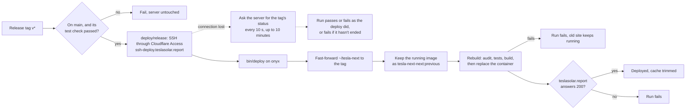

# Tesla Solar Report (Next.js)

The Next.js dashboard at https://teslasolar.report, served from onyx. anton-tesla-api-ws writes the database; this app only reads it.

What each part does, exactly, is in [`openspec/specs/`](openspec/specs/); the redesign's mockups are at https://claude.ai/artifact/7crQGRyQS9J8wSdKYJjD6d.

## Stack

| Layer | Tech | Pinned in |
|---|---|---|
| App | Node 24, Next.js 16 (app router, standalone output), React 19, TypeScript 6 | `.nvmrc`, `package.json`, `Dockerfile` |
| UI | Tailwind 4, shadcn/ui (Radix, `react-day-picker`, `lucide-react` icons, charts on Recharts 3), IBM Plex Sans and Mono through `next/font` | `package.json` |
| Database | PostgreSQL 18 at 192.168.40.5 through `pg`, read-only (a throwaway PostgreSQL 18 in tests) | `package.json` |
| Tests | Vitest, Testing Library, jsdom | `package.json` |
| Serving | onyx in Docker, behind its own Cloudflare tunnel | `docker-compose.yml`, `deploy/` |

## Setup

```sh
nvm install && yarn install
brew install postgresql@18          # the tests start their own server from it
git config core.hooksPath .githooks # run the tests on each commit that stages code
yarn dev                            # http://localhost:3000
```

The pre-commit hook runs Vitest when anything but OpenSpec artifacts or Markdown is staged; a failing test blocks the commit. Skip it with `git commit --no-verify`; the deploy's build still runs every test.

## Environment

Settings live in `.env` at the repository root, never committed; `.env.example` lists them.

| Variable | | What it does |
|---|---|---|
| `DATABASE_URL` | required | the site's database, as the API's login `tsr_app`: `postgresql://tsr_app@192.168.40.5:5432/tsr`. Leave the password out when `PGPASS_FILE` is set. |
| `PGPASS_FILE` | optional | host path of a libpq password file (mode 600) holding the database's password. Compose mounts it read-only and the app reads the password from it. Without it, put the password in `DATABASE_URL`. |
| `SYSTEM_COSTS_FILE` | optional | host path of a JSON file (mode 600, outside the repository) holding what the system cost: `{"solar": …, "powerwalls": …, "sales_tax": …, "credit_rate": …}`, the two prices and the tax in dollars and the federal credit as a fraction. Compose mounts it read-only. The True-Up Tracker's Payback card shows only years worked out from it; without it there is no card. Never commit it or print its figures: the repository and the site are public. |
| `PUSHOVER_USER` | optional | Pushover user key; with `PUSHOVER_TOKEN`, the weekly audit and daily check alert when they fail |
| `PUSHOVER_TOKEN` | optional | Pushover application API token; without both, nothing is sent |

Every session the app opens is read-only and in UTC, so nothing here can change the data the API writes. The database accepts `tsr_app` only from onyx, so a local `next dev` can't read production; pages that need the database work on onyx.

## What the app reads

anton-tesla-api-ws stays the writer: its scheduler reads Tesla and the weather and stores them. This app only reads.

- **Live status** (`/api/live`, a server-sent event stream). anton's scheduler sends each live status as a `pg_notify` on `live_status` about every 10 seconds, each day whose totals it stores on `totals_updated`, each outage refresh that changes `grid_outage` on `outages_updated`, and each change to the site's state stretches in `site_state` on `site_state_updated`. One `LISTEN` connection in the server (`lib/live.ts`, started from `instrumentation.ts`) keeps the latest status and the open `site_state` stretch (read at connect and on each `site_state_updated`) and forwards them to every open page: live status as plain messages, totals as `event: totals`, outages as `event: outages`, the stretch as `event: site_state`. Every page is rendered with the latest status and stretch, so the top bar's live status (the Powerwalls' charge and state, "LAST" with a gray dot once two minutes old, and OFF GRID, OFF GRID TEST or STORM WATCH while the site is off the grid or in storm watch) and the Distribution page's labels show values before any script runs. A tab opens one stream, shared by the top bar and the page (`components/use-live-stream.ts`).
- **A day's history** (`/api/intervals?date=YYYY-MM-DD`), which the Distribution page replays: a TypeScript port of anton's `/api/v2/intervals` (`lib/intervals/`), reading `energy_interval`, `battery_sample`, `vehicle_interval`, `charge_session`, `weather_sample` and the car names anton keeps in `vehicle`. It also lists the day's off-grid spans (`grid_outage`, with their kinds) and storm watch spans (`site_state`), which the Solar page's day view shades.
- **Daily totals over a range** (`/api/range?start_date=&end_date=`, `lib/range.ts`), reading `data` and PG&E's readings in `meter_day`, with the rounding and float sums the site has always shown (ported from anton's `/api/v2/formatted`). The Solar page reads the same function directly and reloads through the route.
- **Impact over a range** (`/api/impact?start_date=&end_date=`, `lib/impact.ts`): the same corrected sums of `data` as `/api/range`, as the shares of the house's use from solar, the Powerwall and the grid. The battery fields come from the live stream instead. The Impact page reads the same function directly.
- **The true-up** (`/api/true-up-years`, `/api/cycles?start_date=&end_date=` and `/api/true-up-cost?start_date=&end_date=`): ported from anton's `/api/v2/true_up_years`, `/api/v2/sheet` and `/api/v2/true_up_cost` (`lib/true-up/`), reading PG&E's meter read dates in `meter_read`, the grid from `meter_day` and `energy_interval`, the rates in `rate_revision` and `nsc_rate`, PG&E's statements and bills in `true_up_statement` and `true_up_statement_cycle`, and the VPP season from `data` and `vpp_payout`. anton's scheduler and scripts write all of them. The True-Up Tracker reads the same functions directly.
- **The true-up savings** (`/api/true-up-savings?start_date=&end_date=`, `lib/true-up/savings.ts`): a true-up year's cost to the house so far, from '23 - '24 on, in three cases: actual, solar with no Powerwalls, and no system. Each case is PG&E's NEM charges plus WestLight's generation, priced from `energy_interval`, with days before April 27, 2026 scaled to PG&E's readings in `meter_day`. WestLight's generation rates before August 2024 aren't published any more, so '23 - '24 is priced at estimates: PG&E's generation rate for each period then, times that period's ratio of WestLight's first known sheet to PG&E's in August 2024 (`lib/true-up/westlight.ts`, marked estimated). Without the Powerwalls the house is dark while the grid is down, so the solar-only and no-system cases import and export nothing during outages and blips. It also splits what the Powerwalls added between held days (they sat out the 4 to 9 p.m. peak with a shortfall to cover, as on Savings-mode or 100%-reserve days), VPP event days (`data.is_vpp`), storm watch days (a `site_state` stretch with storm watch on) and used days, and prices a peak-only case: a simulation of the used days with the Powerwalls covering only 4 to 9 p.m., at the efficiency measured on used days, the other days kept as they were. It answers null for any other range. The True-Up Tracker reads the same function and reloads through the route.
- **WestLight Energy's generation rates** (`lib/true-up/westlight.ts`): the house buys generation from WestLight Energy (Peninsula Clean Energy until 2026), billed on PG&E's bill. The rates are a table in the code, not the database, from the E-TOU-C "Generation rate" column of WestLight's residential rate sheets, plus ECO100's premium and the Net Generation Bonus. They start August 1, 2024, the oldest sheet that survives. When WestLight changes its rates, a few times a year, add a row with the new sheet's effective date and rates from the current sheet on westlightenergy.org's residential rates page, then publish a release. Until then the newest row keeps pricing.
- **Payback** (`/api/payback`, `lib/true-up/payback.ts`): with the costs file (`SYSTEM_COSTS_FILE`), the year solar paid for itself, the year it pays for the whole system, and the Powerwalls' year or that they won't in dollars, counted from PTO (October 22, 2021). The priced years' savings count as they are; '21 - '22 and '22 - '23 are estimated from '23 - '24's by solar output and the average E-TOU-C cost in PCE and PG&E's joint rate comparisons. Only years and the Powerwalls' outage record leave the server; it answers null without the file. The True-Up Tracker reads the same function and reloads through the route.
- **Backup history** (`/api/backup?year=24-25|all`, `lib/backup.ts`): Tesla's backup events from `grid_outage`, each given a kind (commissioning on or before PTO day, October 22, 2021; a test over an `off_grid_intentional` stretch in `site_state`; a blip under a minute; otherwise an outage), for one true-up year (this one by default) or all, with a summary of its outages and the house's energy through them from `energy_interval`. Each outage also carries the batteries rebuilt from its 5-minute intervals (`lib/backup-figures.ts`), since Tesla keeps no charge history: how far they fell below the start, energy in counting at 0.36/0.41 of energy out; for an outage that started full (solar exported with the batteries taking none, within 12 hours before, less than 1 kWh used since), the lowest charge at 0.36 kWh a percent, the kWh left of 36 and the hours left at the hour-before draw; and whether solar refilled them (more than 36 kWh out). Each also carries the weather around its start from `weather_sample`, the summary its closest call and blips per true-up year, and the page groups storm days (events less than 6 hours apart). The Impact page's Backup section reads the same function and reloads through the route on `outages` and `site_state` events.
- **The top ten** (`/api/top-ten`, `lib/top-ten.ts`): the ten days with the most solar, the ten days and months with the most sent to PG&E net of imports, from `data` and `meter_day` corrected as `/api/range` is, and the ten longest outages in hours. The export rankings leave VPP event days out, as the Top Ten page does by default; `?vpp=with` includes them. Rows whose figures read the same to a tenth rank newest first, and each row also carries its ISO `day` or `month`. The Top Ten page reads the same function directly and reloads through the route.

## The Solar page

The Solar page (`/`) keeps its range and its open day in the address: `/?start=2026-10-01&end=2026-10-31` shows October 2026, and `&day=2026-10-14` opens that day. A missing or invalid range shows the current month; an invalid day is ignored. The server renders both from the address, and a `totals` event on the live stream reloads the bars or the day in place through `/api/range` and `/api/intervals`.

## Deploy

The app runs on onyx (`onyx@192.168.40.63`) in `~/tesla-next`, a clone of this repository, with no published port. Its own Cloudflare tunnel container, `~/tesla-next-tunnel`, joins the compose network and Cloudflare routes `teslasolar.report` to `http://next:3000`; `next.teslasolar.report`, its address before the cutover, is a Cloudflare redirect to it that keeps the path and query. The only remote is `origin` (`git@github.com:toddseller/tesla-next.git`).

Every pull request to `main` runs the `Tests` workflow. Its one job, `test`, builds the image (which audits the shipped dependencies and runs every test) and lints the workflows. The `main` ruleset requires it before a merge.

### Releasing

Publish a GitHub release with a new tag in the form `vYYYY.MM.DD`, or `vYYYY.MM.DD.N` for another release that day, on `main`. Use the web UI: the tag ruleset rejects a `v*` tag pushed with git.

The `Deploy` workflow then:



- It waits for a `test` check still running, for about 15 minutes.
- Only one deploy runs at a time; another waits for it.
- Each deploy reruns the dependency audit against that day's advisories, so a release that passed its `test` check can still fail on an advisory published since.
- The deploy key can only run `bin/deploy`, which takes two requests: `deploy <tag>` and `status <tag>`. A deploy only moves the server forward to a tag on `main`; it refuses a malformed request, a dirty checkout, a moved tag and a tag behind the server.
- `bin/deploy` keeps each tag's log and, once it ends, its exit status in `~/.local/state/tesla-next-deploy/` on onyx (`<tag>.log`, `<tag>.result`). `status <tag>` answers `running`, `succeeded`, `failed <status>` or `unknown`, then the log, and changes nothing.
- Cloudflare sometimes closes the workflow's SSH session mid-deploy while the server carries on. `deploy/release` then asks for the tag's status instead of failing the run, and passes or fails with the deploy's own result and log.
- A failed run can be retried with "Re-run jobs": deploying the tag the server is already on rebuilds and checks it again.
- A deploy runs the `bin/deploy` the server had before it, so a release that changes `bin/deploy` and depends on the change is deployed twice.

### Rolling back

Each deploy of a new tag keeps the image it replaced as `tesla-next-next:previous`; retrying the same tag leaves it alone. To restore it without a build:

```sh
ssh onyx@192.168.40.63
cd ~/tesla-next
docker tag tesla-next-next:previous tesla-next-next:latest
docker compose up -d --no-build
```

The checkout stays at the newer tag, so the next release deploys normally. To undo a release for good, revert it on `main` and release again; never force-push.

### Deploying by hand

If the workflow or the tunnel is down, deploy from the checkout on onyx over the LAN. It fast-forwards to `main`, keeps the rollback image and rebuilds with a fresh audit:

```sh
ssh onyx@192.168.40.63 'cd ~/tesla-next && git pull --ff-only && docker tag tesla-next-next:latest tesla-next-next:previous && AUDIT_RUN=$(date +%s) docker compose up -d --build'
```

## Dependency audit

Every image build audits what the app ships before it runs the tests, and a known advisory stops it (and the deploy):

- `scripts/audit.mjs` fails on a high or critical advisory in a runtime package (`dependencies` in `package.json`), and lists the rest. Advisories in build and test tools (`devDependencies`) are listed and never fail the build. An audit that can't finish, such as when the registry is unreachable, fails the build.
- To waive an advisory that doesn't apply, add its GitHub advisory ID to `WAIVED` in `scripts/audit.mjs` with the reason.
- Every dependency is pinned to an exact version, so the image ships what was checked.

### Weekly audit

Advisories published between deploys are caught by `deploy/weekly-audit`. A systemd user timer runs it on onyx every Monday at 06:30 Pacific time, half an hour after anton-tesla-api-ws's, and a run missed while onyx was off happens at its next boot. It builds the image's `test` stage (audit and tests) from the deployed commit without touching the running container. When that fails, it sends a Pushover alert through `deploy/pushover` with the end of the build's output; a passing run sends nothing. It then asks the running site for its checks through `deploy/checks` (`/api/checks`: Tesla's grid figures against PG&E's meter in `meter_day`, whether that meter is current, and solar output against past years) and sends the failing lines, or an alert when the site doesn't answer; a week where all pass sends nothing. Its last output is in `~/tesla-next-weekly-audit.log`.

A second timer runs `deploy/checks /api/checks/daily Daily` every day at 07:00 Pacific: yesterday's highest 5-minute solar output, on a bright day (forecast at least 60% of a clear day's for that date, from every stored year's forecasts), against the usual peak of the bright days in the 30 before it, so a failing microinverter alerts the next morning in any season. A day with no solar stored fails too. Its output is in the user journal (`journalctl --user -u tesla-next-daily-check`).

Install the units once, and again after changing them:

```sh
ssh onyx@192.168.40.63 mkdir -p .config/systemd/user
scp deploy/tesla-next-weekly-audit.* deploy/tesla-next-daily-check.* onyx@192.168.40.63:.config/systemd/user/
ssh onyx@192.168.40.63 'systemctl --user daemon-reload && systemctl --user enable --now tesla-next-weekly-audit.timer tesla-next-daily-check.timer'
```

Check them with `ssh onyx@192.168.40.63 systemctl --user list-timers 'tesla-next-*'`, and run one at once with `systemctl --user start tesla-next-weekly-audit` (or `tesla-next-daily-check`) there.

To check without building:

```sh
yarn audit --groups dependencies --json | node scripts/audit.mjs
```

## Tests

```sh
yarn vitest run
```

Every test runs everywhere: locally, in the pre-commit hook and in the Docker build. Tests that need a database get their own: a throwaway PostgreSQL 18 started for the run, on a Unix socket in a temporary directory, removed when the run ends. They never touch production.

The throwaway database is loaded with `test/schema.sql`, the production schema of the tables `/api/intervals`, `/api/range`, `/api/backup` and the true-up routes read; its header says how to regenerate it after anton-tesla-api-ws changes them.

It needs PostgreSQL 18's binaries. On the Mac, `brew install postgresql@18` (the tests find Homebrew's copy; `pg_config` on the PATH may belong to an older version). Anywhere else, put them on the PATH or point `PG_BIN` at their folder:

```sh
PG_BIN=/usr/lib/postgresql/18/bin yarn vitest run
```
