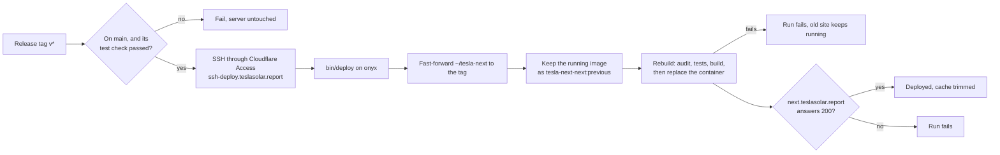

# Tesla Solar Report (Next.js)

The Next.js dashboard for https://teslasolar.report, being moved here from anton-tesla-api-ws one page at a time. Until the cutover it runs at https://next.teslasolar.report, and a page not moved yet links to its counterpart on the live site. The API in anton-tesla-api-ws keeps writing the database; this app only reads it.

What each part does, exactly, is in [`openspec/specs/`](openspec/specs/); the redesign's mockups are at https://claude.ai/artifact/7crQGRyQS9J8wSdKYJjD6d.

## Stack

| Layer | Tech | Pinned in |
|---|---|---|
| App | Node 24, Next.js 16 (app router, standalone output), React 19, TypeScript 6 | `.nvmrc`, `package.json`, `Dockerfile` |
| UI | Tailwind 4, shadcn/ui (Radix, `react-day-picker`, `lucide-react` icons, charts on Recharts 3), IBM Plex Sans and Mono through `next/font` | `package.json` |
| Database | PostgreSQL 18 at 192.168.40.5 through `pg`, read-only (a throwaway PostgreSQL 18 in tests) | `package.json` |
| Tests | Vitest, Testing Library, jsdom | `package.json` |
| Serving | onyx in Docker, behind its own Cloudflare tunnel | `docker-compose.yml`, `deploy/` |

## Setup

```sh
nvm install && yarn install
brew install postgresql@18          # the tests start their own server from it
git config core.hooksPath .githooks # run the tests on each commit that stages code
yarn dev                            # http://localhost:3000
```

The pre-commit hook runs Vitest when anything but OpenSpec artifacts or Markdown is staged; a failing test blocks the commit. Skip it with `git commit --no-verify`; the deploy's build still runs every test.

## Environment

Settings live in `.env` at the repository root, never committed; `.env.example` lists them.

| Variable | | What it does |
|---|---|---|
| `DATABASE_URL` | required | the site's database, as the API's login `tsr_app`: `postgresql://tsr_app@192.168.40.5:5432/tsr`. Leave the password out when `PGPASS_FILE` is set. |
| `PGPASS_FILE` | optional | host path of a libpq password file (mode 600) holding the database's password. Compose mounts it read-only and the app reads the password from it. Without it, put the password in `DATABASE_URL`. |
| `PUSHOVER_USER` | optional | Pushover user key; with `PUSHOVER_TOKEN`, the weekly audit alerts when it fails |
| `PUSHOVER_TOKEN` | optional | Pushover application API token; without both, nothing is sent |

Every session the app opens is read-only and in UTC, so nothing here can change the data the API writes. The database accepts `tsr_app` only from onyx, so a local `next dev` can't read production; pages that need the database work on onyx.

## What the app reads

anton-tesla-api-ws stays the writer: its scheduler reads Tesla and the weather and stores them. This app only reads.

- **Live status** (`/api/live`, a server-sent event stream). Flask sends each live status as a `pg_notify` on `live_status` about every 10 seconds, and each day whose totals it stores on `totals_updated`. One `LISTEN` connection in the server (`lib/live.ts`, started from `instrumentation.ts`) keeps the latest status and forwards both to every open page: live status as plain messages, totals as `event: totals`. The Distribution page is rendered with the latest status, so its labels show values before any script runs.
- **A day's history** (`/api/intervals?date=YYYY-MM-DD`), which the Distribution page replays: a TypeScript port of Flask's `/api/v2/intervals` (`lib/intervals/`), reading `energy_interval`, `battery_sample`, `vehicle_interval`, `charge_session`, `weather_sample` and the car names anton keeps in `vehicle`. Until Flask's endpoint is retired, both must return the same JSON for every date:

  ```sh
  node scripts/compare-intervals.mjs [first-date] [last-date]   # teslasolar.report vs next.teslasolar.report
  ```

  It prints each mismatch's date and first differing field, and exits non-zero on any. Cloudflare's rate limit refuses either public host after about 100 requests (and then also the browser's live stream from the same address, until the limit clears), so run a full comparison on onyx, in a throwaway container on both apps' networks:

  ```sh
  docker run -d --name tesla-next-compare --network tesla-next_default node:24.22.2-alpine3.24 sleep 3600
  docker network connect anton-tesla-api-ws_default tesla-next-compare
  docker cp scripts/compare-intervals.mjs tesla-next-compare:/compare.mjs
  docker exec -e FLASK=http://nginx/api/v2/intervals -e NEXT=http://next:3000/api/intervals tesla-next-compare node /compare.mjs
  docker rm -f tesla-next-compare
  ```

- **Daily totals over a range** (`/api/range?start_date=&end_date=`): a TypeScript port of Flask's `/api/v2/formatted` (`lib/range.ts`), reading `data` and PG&E's readings in `meter_day`, with Flask's rounding and its float sums. The Solar page reads the same function directly; the route exists so a script can hold it to Flask's answers until Flask's endpoint is retired. The script compares a sweep of about 90 ranges (every month, every true-up and calendar year, both sides of the 31-day limit, and the ways Flask cuts periods); run it the same way, with `scripts/compare-range.mjs` and `FLASK=http://nginx/api/v2/formatted NEXT=http://next:3000/api/range`. It imports `compare-intervals.mjs`, so copy both into the container.

## The Solar page

The Solar page (`/`) keeps its range and its open day in the address: `/?start=2026-10-01&end=2026-10-31` shows October 2026, and `&day=2026-10-14` opens that day. A missing or invalid range shows the current month; an invalid day is ignored. The server renders both from the address, and a `totals` event on the live stream reloads the bars or the day in place through `/api/range` and `/api/intervals`.

## Deploy

The app runs on onyx (`onyx@192.168.40.63`) in `~/tesla-next`, a clone of this repository, with no published port. Its own Cloudflare tunnel container, `~/tesla-next-tunnel`, joins the compose network and Cloudflare routes `next.teslasolar.report` to `http://next:3000`. The only remote is `origin` (`git@github.com:toddseller/tesla-next.git`).

Every pull request to `main` runs the `Tests` workflow. Its one job, `test`, builds the image (which audits the shipped dependencies and runs every test) and lints the workflows. The `main` ruleset requires it before a merge.

### Releasing

Publish a GitHub release with a new tag in the form `vYYYY.MM.DD`, or `vYYYY.MM.DD.N` for another release that day, on `main`. Use the web UI: the tag ruleset rejects a `v*` tag pushed with git.

The `Deploy` workflow then:



- It waits for a `test` check still running, for about 15 minutes.
- Only one deploy runs at a time; another waits for it.
- Each deploy reruns the dependency audit against that day's advisories, so a release that passed its `test` check can still fail on an advisory published since.
- The deploy key can only run `bin/deploy`, and `bin/deploy` only moves the server forward to a tag on `main`. It refuses a malformed request, a dirty checkout, a moved tag and a tag behind the server.
- A failed run can be retried with "Re-run jobs": deploying the tag the server is already on rebuilds and checks it again.
- A deploy runs the `bin/deploy` the server had before it, so a release that changes `bin/deploy` and depends on the change is deployed twice.

### Rolling back

Each deploy of a new tag keeps the image it replaced as `tesla-next-next:previous`; retrying the same tag leaves it alone. To restore it without a build:

```sh
ssh onyx@192.168.40.63
cd ~/tesla-next
docker tag tesla-next-next:previous tesla-next-next:latest
docker compose up -d --no-build
```

The checkout stays at the newer tag, so the next release deploys normally. To undo a release for good, revert it on `main` and release again; never force-push.

### Deploying by hand

If the workflow or the tunnel is down, deploy from the checkout on onyx over the LAN. It fast-forwards to `main`, keeps the rollback image and rebuilds with a fresh audit:

```sh
ssh onyx@192.168.40.63 'cd ~/tesla-next && git pull --ff-only && docker tag tesla-next-next:latest tesla-next-next:previous && AUDIT_RUN=$(date +%s) docker compose up -d --build'
```

## Dependency audit

Every image build audits what the app ships before it runs the tests, and a known advisory stops it (and the deploy):

- `scripts/audit.mjs` fails on a high or critical advisory in a runtime package (`dependencies` in `package.json`), and lists the rest. Advisories in build and test tools (`devDependencies`) are listed and never fail the build. An audit that can't finish, such as when the registry is unreachable, fails the build.
- To waive an advisory that doesn't apply, add its GitHub advisory ID to `WAIVED` in `scripts/audit.mjs` with the reason.
- Every dependency is pinned to an exact version, so the image ships what was checked.

### Weekly audit

Advisories published between deploys are caught by `deploy/weekly-audit`. A systemd user timer runs it on onyx every Monday at 06:30 Pacific time, half an hour after anton-tesla-api-ws's, and a run missed while onyx was off happens at its next boot. It builds the image's `test` stage (audit and tests) from the deployed commit without touching the running container. When that fails, it sends a Pushover alert through `deploy/pushover` with the end of the build's output; a passing run sends nothing. Its last output is in `~/tesla-next-weekly-audit.log`.

Install the units once, and again after changing them:

```sh
ssh onyx@192.168.40.63 mkdir -p .config/systemd/user
scp deploy/tesla-next-weekly-audit.service deploy/tesla-next-weekly-audit.timer onyx@192.168.40.63:.config/systemd/user/
ssh onyx@192.168.40.63 'systemctl --user daemon-reload && systemctl --user enable --now tesla-next-weekly-audit.timer'
```

Check it with `ssh onyx@192.168.40.63 systemctl --user list-timers tesla-next-weekly-audit.timer`, and run it at once with `systemctl --user start tesla-next-weekly-audit` there.

To check without building:

```sh
yarn audit --groups dependencies --json | node scripts/audit.mjs
```

## Tests

```sh
yarn vitest run
```

Every test runs everywhere: locally, in the pre-commit hook and in the Docker build. Tests that need a database get their own: a throwaway PostgreSQL 18 started for the run, on a Unix socket in a temporary directory, removed when the run ends. They never touch production.

The throwaway database is loaded with `test/schema.sql`, the production schema of the tables `/api/intervals` and `/api/range` read; its header says how to regenerate it after anton-tesla-api-ws changes them.

It needs PostgreSQL 18's binaries. On the Mac, `brew install postgresql@18` (the tests find Homebrew's copy; `pg_config` on the PATH may belong to an older version). Anywhere else, put them on the PATH or point `PG_BIN` at their folder:

```sh
PG_BIN=/usr/lib/postgresql/18/bin yarn vitest run
```
