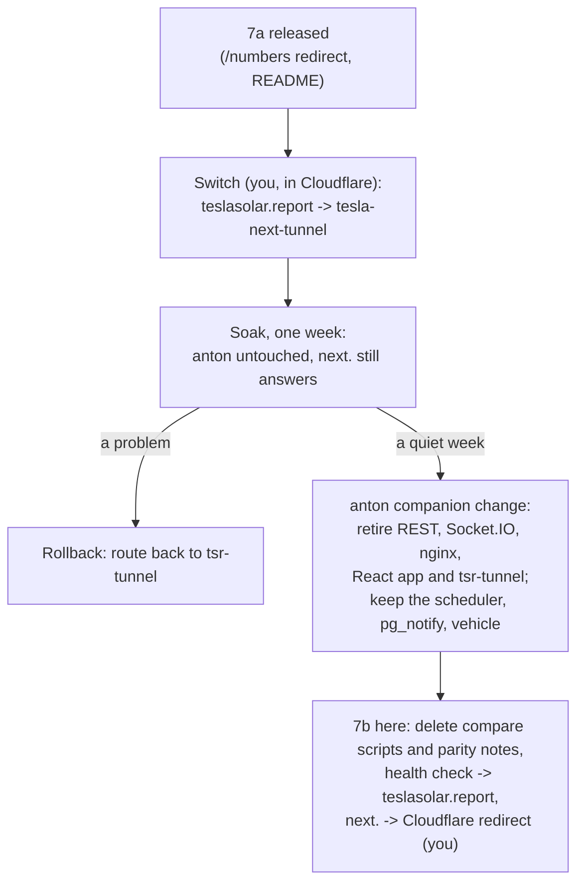

# Design

## Context

See proposal.md for why. Today teslasolar.report reaches anton's nginx through anton's tunnel (`tsr-tunnel`), and nginx serves the React app and proxies `/api/v2` and `/socket.io` to Flask. next.teslasolar.report reaches tesla-next through `tesla-next-tunnel`. Both tunnels' routes live in Cloudflare. tesla-next reads the database only; Flask's scheduler writes it and sends `live_status` and `totals_updated` through `pg_notify`, and keeps the `vehicle` table.

tesla-next already serves every address anton's site has (`/`, `/impact`, `/distribution` with its `?at=` replay links, `/true-up`, `/top`) except `/numbers`, which anton redirects to `/true-up`. It already sends the same security headers anton's nginx does (`next.config.ts`), and a CSP that allows Cloudflare's analytics beacon.

## Goals / Non-Goals

**Goals:**
- teslasolar.report moves to tesla-next with a one-step rollback for a week.
- Every address a visitor may have saved keeps working after the switch.

**Non-Goals:**
- Anything that only matters once Flask's HTTP is gone (change 7b).
- Changes to anton-tesla-api-ws; its retirement is its own change, in its own repo.

## Decisions

**The cutover runs in this order, and only the last two steps are hard to undo.**

During the soak I check, on the switched site, what only time shows: a `totals` event after midnight's `finish_yesterday` reloading yesterday, and the month turning over on the Solar page's This month. The compare scripts keep running against Flask directly on onyx (`http://nginx/api/v2`), which the switch doesn't touch.

**The redirect is in `next.config.ts`, not a page.** One `redirects()` entry, permanent, beside the security headers, so no page component or route exists only to bounce. Next answers it with a 308 and keeps the query string, where anton's client-side redirect dropped it; nothing ever linked `/numbers` with a query.

**The deploy's health check stays on next.teslasolar.report until 7b.** Moving it now would make a release before the switch check anton's site, which answers 200 whatever tesla-next does. Through the soak next.teslasolar.report reaches this app, so the check stays meaningful; 7b moves it once next. becomes a redirect.

**The README's compare instructions stay until 7b,** since the scripts are still how the soak is checked against Flask.

## Risks / Trade-offs

- [A page left open on the old site at the switch loses its Socket.IO connection] → a reload brings up the new site; nothing to build.
- [Cloudflare keeps serving cached copies of anton's assets for a while] → anton's assets are hashed file names tesla-next never requests, and both sites send pages uncached, so a cached asset can only reach a tab already open on the old site.
- [Phones that installed the old site as an app] → they keep its start address, `/`, which tesla-next serves; the new manifest and icons apply on the next install.

## Migration Plan

1. Merge and release this change (you); the deploy checks next.teslasolar.report as before.
2. Switch (you): in Cloudflare, teslasolar.report's public hostname moves from `tsr-tunnel` to `tesla-next-tunnel`, service `http://next:3000`.
3. I check teslasolar.report: every page answers 200 without a CSP violation, `/numbers` lands on `/true-up`, a replay link opens, and the live stream connects.
4. Soak for a week. Rollback at any point: move the hostname back to `tsr-tunnel`, service `http://nginx:80`.
5. After a quiet week: anton's companion change, then 7b.

## Rollout

- **Before the pull request (November 8, 2026):** locally under `yarn build && yarn start`, on a throwaway database with the production schema, `curl -I /numbers` answered `308 Permanent Redirect` with `Location: /true-up` (and `/numbers?x=1` kept its query). In headless Chromium, `/numbers` landed on `/true-up` with the heading "True-Up Tracker" and "True-Up" as the current page, with no console message.
- **Release `v2026.11.08.6`** passed the gate and its Deploy run finished at 19:46 UTC; next.teslasolar.report answered `/numbers` with a 308 to `/true-up`.
- **The switch (November 8, 2026):** `tsr-tunnel` had only `teslasolar.report` → `http://nginx:80`; the hostname moved to `tesla-next-tunnel` (`91e5b077-1af0-4e85-957c-d94bb6586fdc`), service `http://next:3000`, beside `next.teslasolar.report` and `ssh-deploy.teslasolar.report`. `www.teslasolar.report` has no record, so nothing else moved.
- **On teslasolar.report after the switch:** `/`, `/impact`, `/distribution`, `/true-up` and `/top` answered 200 with tesla-next's per-request nonce CSP, and `/numbers` a 308 to `/true-up`, which opened the True-Up Tracker with "True-Up" marked. No page logged a console message; headless Chromium's software WebGL printed its own GL driver warnings on Distribution, and in Chrome with a GPU the page logged nothing. `/distribution?at=2026-11-07T12:30` opened paused (Play shown, `at` kept). With the Solar page open, a `totals` event for 2026-11-08 at 20:00 UTC refetched `/api/range?start_date=2026-11-01&end_date=2026-11-30` (200) without reloading the page. On onyx against Flask directly, every compare script found no mismatch: the top ten, 22 true-up ranges (twice), 156 impact ranges, 94 ranges and 1,866 interval dates.
