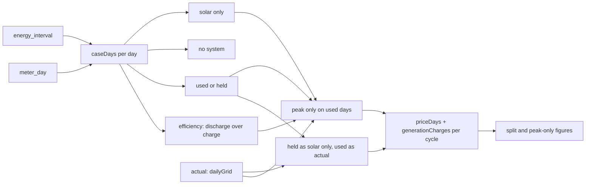

# Design

## Context

See proposal.md for why. The savings come from `lib/true-up/savings.ts`: `caseDays` rebuilds each day's grid for the solar-only and no-system cases in one query over `energy_interval` (scaled to `meter_day` before April 27, 2026), and `trueUpSavings` prices each case per billing cycle with `priceDays` (PG&E) and `generationCharges` (WestLight), flooring NEM cases at the minimum delivery charges. A day's grid is a `DayGrid`: imports, exports and the net from 4 to 9 p.m., in Wh. The card's text comes from `savingsText` in `lib/true-up/text.ts`.

Read-only queries on November 8, 2026 (recorded in true-up-savings' archived design and the exploration that led here) showed:
- winter days at 100% reserve with the batteries idle and the grid topping them up about 0.5 kWh a day;
- summer Self-Powered days covering 4 to 9 p.m. completely and moving 11 to 17 kWh a day into the night;
- Savings-mode days on or before poor solar, with the batteries full and out of the peak while the house imported 2.8 to 8.1 kWh in those hours.

On October 26 and 28, 2026 the batteries took 28 to 29 kWh of solar from 20% to about 90%, so their usable size is about 40 kWh; the largest 4 to 9 p.m. shortfall in the queried days was about 9 kWh, and in a whole year 24 to 26 kWh (task 3.3).

## Goals / Non-Goals

**Goals:**
- Explain the Powerwalls' bill effect from the house's own days, and price one clear alternative.
- Reuse the three cases' days and pricing; the new cases are more `DayGrid`s through the same pricers.

**Non-Goals:**
- Simulating the batteries interval by interval with a state of charge. The peak-only case assumes they hold one evening's shortfall, which a 40.5 kWh bank does even on the year's largest (26 kWh, against about 32 kWh above a 20% reserve); a day-by-day state of charge would need every interval in TypeScript (about 105,000 a year) for no change in the answer.
- Pricing Self-Powered all year, or reserves other than what happened. Held days stay as they were in every case: keeping charge is the owner's choice, not the habit being tested.
- Valuing backup in dollars. Outage history from anton's follow-up will sit beside the held days' cost.

## Decisions

**`caseDays` returns four more figures per day** from the same query: the solar-only case's imports from 4 to 9 p.m. (the shortfall the batteries could cover), its exports from 4 to 9 p.m., and the Powerwalls' discharge from 4 to 9 p.m. and charge and discharge over the day. Battery columns are Tesla's own and were never part of the metering fault, so they need no scaling. Classifying from the shortfall, not the grid import, keeps days before the fix classified alike.

**VPP event days are a kind of their own, taken from `data.is_vpp`** as the VPP credit and the Top Ten take them (decided November 8, 2026). On an event day the batteries export at peak, which under NEM2 earns peak-rate credit on the bill on top of Tesla's payment. Counting those days as used would put that credit in "storing solar", have peak-only throw it away, and fold the event's discharge and recharge into the efficiency. The owner takes part in events in every mode, so peak-only keeps them as they were, and the split prices them as a third part.

**Held is a threshold on behavior, not on mode.** A day is held when the batteries gave less than 1 kWh to a shortfall over 1 kWh between 4 and 9 p.m. The owner switches modes by hand, sometimes a day before a cloudy one, and Tesla reports no mode history, so behavior is the only record. The exploration's 22 days split cleanly at these thresholds: every held day gave 0.0 to 0.5 kWh against 3.8 to 8.1 kWh imported, and every used day gave 3.9 kWh or more.

**The split prices two more cases.** Held-as-solar-only takes each held day's solar-only grid and every other day's actual grid; held-and-VPP-as-solar-only also swaps in the VPP event days. Both are priced and floored like the NEM cases. Held part = the first less actual; VPP part = the second less the first; used part = solar-only cost less the second. The parts add up to what the Powerwalls added by construction, the held part taking the rounding. Pricing nets each billing cycle's periods, so a day's share can't be priced alone; replacing one group of days and repricing is the honest way to attribute cost under NEM2, and it gives the same total.

**Peak-only rebuilds each used day from its solar-only day.** The shortfall from 4 to 9 p.m. comes off the imports and the peak net. Refilling it, divided by the efficiency, comes off the off-peak exports, which the solar-only day's exports less its 4 to 9 p.m. exports give; any part they can't cover is imported off-peak. Held days keep their actual grid. The efficiency is the Powerwalls' discharge over their charge on the used days. That ratio folds the used days' standby draw in with the round-trip loss, so peak-only carries the overheads the batteries really had on those days. Held days' top-ups stay out of it: they are the held part's cost, and counting them again would charge peak-only for them twice (ponytail-review finding, November 8, 2026).

**The Powerwalls get a row of their own under the key** (what-if B of the mockup, https://claude.ai/artifact/Hri55pw2tcBD9dEY6NvbGJ, chosen November 8, 2026; A grew the Powerwalls entry inside the key's row). Under a divider, three columns: the bill effect with the VPP credit; the two parts, keeping charge and storing solar, each with its day count; and a dashed panel, "What if (simulation)", with the peak-only difference and the NEM2 sentence. The dashed panel keeps the one simulated figure apart from the estimates of real bills. On a phone the row stacks: the bill line with its parts and the VPP credit indented under it, then the panel.

## Risks / Trade-offs

- [A Savings-mode day before a cloudy one may still cover part of the peak and read as used] → The thresholds are 1 kWh; the exploration's days split cleanly. The onyx run counts days close to them so the threshold can be checked against a full year.
- [Peak-only assumes the batteries hold one evening's shortfall] → The year's largest is 24 to 26 kWh (likely a car charging at peak), under the 32 kWh a 40.5 kWh bank holds above a 20% reserve. It is closer than first thought, so the code marks it as a shortcut with its limit.
- [The efficiency includes VPP exports and their recharge] → They are a few days a season and the same in both cases. The run reports the efficiency per year so an odd value shows.
- [Peak-only is a simulation the owner may act on] → The card labels it one and words it as "about"; the figure compares like with like (the same pricers, the same held days, the same overheads).

## Migration Plan

Release as usual. The database and anton are unchanged. Rolling back is the previous release.

## Open Questions

None. The bank's size was answered on November 8, 2026: two Powerwall+ and one Powerwall, each 13.5 kWh usable, 40.5 kWh in all, which matches the about 40 kWh the October 26 and 28 charges showed.

## Results

- **The real figures (task 3.3, November 8, 2026),** from a read-only run on onyx as true-up-savings' task 3.4 ran:

  | Year | Powerwalls added | Held days | Used days | Peak-only vs. actual | Efficiency | Largest shortfall | Near the thresholds |
  |---|---|---|---|---|---|---|---|
  | '24 - '25 | -$132.28 | 161 days, -$94.45 | 203 days, -$37.83 | $900.57 against $946.82, $46.25 less | 0.828 | 26.2 kWh | 6 days |
  | '25 - '26 | -$150.84 | 129 days, -$83.08 | 238 days, -$67.76 | $1,035.44 against $1,118.07, $82.63 less | 0.850 | 24.5 kWh | 1 day |
  | '26 - '27 through November 8 | -$23.95 | 9 days, -$19.06 | 26 days, -$4.89 | $133.50 against $135.15, $1.65 less | 0.850 | 10.5 kWh | 1 day |

  Held days fall almost entirely from November to March (100% reserve), with a few in April, August and September (Savings mode before poor solar): '24 - '25 held 15, 30, 29, 31, 27, 23 and 3 days from October to April and 3 in August; '25 - '26 held 10, 27, 31, 31 and 20 from October to February, 8 in April and 2 in September. Keeping charge is the larger cost, $83 to $94 a year. Peak-only would have turned '25 - '26's used days from -$67.76 to about +$15. Few days sit near the 1 kWh thresholds, so the classification is stable. The efficiency, 0.83 to 0.85, is lower than a round trip alone because it carries standby draw.
- **The card under the production build (task 4.4, November 8, 2026):** `yarn build && yarn start` locally against the throwaway database seeded as for true-up-savings, with December to February made held (no evening discharge, the grid running the house). '25 - '26 answered 90 held and 277 used days. In headless Chromium: the Powerwalls' row showed its bill effect, "Keeping charge, 90 days" and "Storing solar, 277 days" with their amounts, and the dashed "What if (simulation)" panel with the peak-only line and the NEM2 sentence (here "About $131 more": the seed's batteries discharge only in the evening and its efficiency is 0.69); at 375 px the row stacked as mockup B and the page was 375 wide; All time showed no card; no console message or CSP violation.
- **Corrected figures (task 3.4, November 8, 2026),** after VPP event days became their own kind and the efficiency moved to used days only, from the same read-only run on onyx (trueUpSavings alone took 735, 635 and 57 ms):

  | Year | Held days | VPP event days | Used days | Peak-only vs. actual | Efficiency |
  |---|---|---|---|---|---|
  | '24 - '25 | 161, -$94.45 | 7, +$73.28 | 196, -$111.11 | $820.23 against $946.82, $126.59 less | 0.837 |
  | '25 - '26 | 129, -$83.08 | 6, +$42.50 | 232, -$110.26 | $985.39 against $1,118.07, $132.68 less | 0.871 |
  | '26 - '27 through November 8 | 9, -$19.05 | 2, +$3.53 | 24, -$8.42 | $126.56 against $135.17, $8.61 less | 0.904 |

  The first run's used days had carried the VPP events' peak-export credit ($42 to $73 a year), so storing solar overnight looked $40 to $70 a year cheaper than it is, and peak-only, which threw that credit away, looked $50 to $80 a year worse. Storing solar overnight costs about $110 a year; peak-only on the used days would have saved $127 to $133, turning '25 - '26's used days from -$110.26 to about +$22. The task 3.3 table above is superseded.
- **Rollout (November 8, 2026, Pacific):** PR #16 merged and released as `v2026.11.08.9`; the Deploy run succeeded at 03:13:03 UTC on November 9. On teslasolar.report, in headless Chromium, the Powerwalls row matched task 3.4's corrected figures: '24 - '25 $132 cost on the bill beside the 2025 season's $728 payout, keeping charge 161 days $94 cost, storing solar 196 days $111 cost, VPP events 7 days $73 saved, about $127 less with peak-only; '25 - '26 $151, $368 estimate, 129 days $83, 232 days $110, 6 days $43 saved, about $133 less; the current year $24, 9 days $19, 24 days $8, 2 days $4 saved, about $9 less. No console message; at 375 px the page was 375 wide. On onyx, `scripts/compare-true-up.mjs` found 22 ranges and 0 mismatches against Flask.
