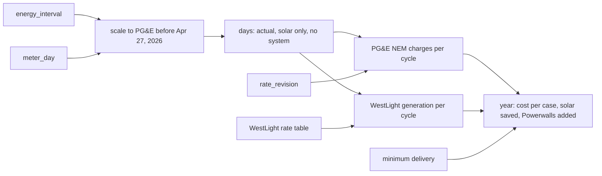

# Design

## Context

See proposal.md for why. The True-Up Tracker prices the grid through `lib/true-up/pricing.ts`: `priceDays(first, last, days, revisions)` takes each day as `{ imported, exported, peak_net }` in Wh and returns a cycle's NEM charges, split by season and PG&E rate revision. `dailyGrid` (`lib/true-up/grid.ts`) builds those days from `energy_interval`, or from PG&E's `meter_day` before April 27, 2026, when Tesla's grid readings were about half the meter's. `cycleGrids` gives each billing cycle's days, and `minimumDelivery` the minimum delivery charges over a span. PG&E's rates start 2023-09-01 (`seed_rates.py`), so '23 - '24 is the first true-up year that can be priced.

`energy_interval` keeps every 5-minute interval's flows. Its house columns include car charging (`lib/solar/day-views.ts`: "their home flows still include charging"), so the house's use is everything the site drew. `/api/true-up-cost` must answer as Flask's until 7b (`scripts/compare-true-up.mjs`), so it can't gain fields.

WestLight Energy is Peninsula Clean Energy renamed (its old site redirects to westlightenergy.org), and it publishes dated residential rate sheets with E-TOU-C generation by season and period. The October 2026 bill (cycle 2026-09-03 to 10-04) shows how WestLight bills: each season-and-period net times its rate, one line per period; ECO100's premium (then $0.01) on the kWh of the periods netting an import; the Net Generation Bonus (then -$0.01) on those netting an export; the total charged against a NEM credit balance, which WestLight cashes out each April.

## Goals / Non-Goals

**Goals:**
- The three cases share one pricer, so their differences come from the energy, not from how each is priced.
- The actual case is the True-Up Tracker's own grid, so the savings start from the same days the page shows.

**Non-Goals:**
- Using PG&E's statements for the actual case. A statement prices what PG&E billed, and the two other cases can only be calculated; mixing them would put billing quirks into the savings. The card says "estimate", and the True-up tile keeps the statement.
- The Base Services Charge and the Energy Commission Surcharge. The first is the same in every case, and the second is about a hundredth of a cent per kWh.
- Pricing years before '24 - '25 (see Rates), payback, the value of backup during outages, or WestLight's generation on the existing tiles.
- Taking WestLight's credit cash-out cap into account. The cap ($10,000 a year) is far above this house's balances.

## Decisions

**One query builds a year's days in all three cases.** For each day it returns the intervals' sums for actual, solar-only and no-system imports, exports and peak net, plus whether the day was rebuilt. Scaling happens in the query: per day and per period (peak, off-peak), window sums of the intervals' imports and exports give the factors against `meter_day`. A period with nothing to scale spreads PG&E's energy evenly over its intervals. Each interval's house use becomes its stored use plus the change in imports less the change in exports, the per-interval form of `extraImported` and `extraExported` in `lib/range.ts`. The solar-only net is house use less solar, split into imports and exports interval by interval before summing. Returning about 730 rows a year beats returning about 105,000 intervals to TypeScript on every page load. The alternative, scaling in TypeScript, is easier to read but makes each load of a year move the whole interval table.

**The actual case keeps `dailyGrid`'s days.** On a rebuilt day the scaled sums equal `meter_day`'s by construction, which is a test (spec: "The day matches the meter"). Days from April 27, 2026 are the intervals as stored in every case.

**PG&E's charges reuse `priceDays` per cycle,** over the spans `cycleGrids` already returns, once for each case's days. The NEM cases take the larger of their summed charges and `minimumDelivery` from the year's first day to its last counted day, since PG&E keeps unused credit. The no-system case is not on NEM, so its charges stand. Through the same formula, with nothing exported, its lines reduce to a plain E-TOU-C delivery bill. The net equals imports, the non-bypassable charges' net adjustment cancels, and the baseline credit applies to imports up to the allowance.

**WestLight's rates are a dated table in `lib/true-up/westlight.ts`,** like `VPP_RATE` in `lib/true-up/cost.ts`. Each revision has its effective date, its four generation rates, its ECO100 premium and Net Generation Bonus, and its source. A table in anton (`westlight_rate`, seeded like `seed_rates.py`) would match how PG&E's rates live. But this app is read-only, anton's web side is about to be retired, and the rates change a few times a year, so a code edit plus a release is a fair cost. A new revision is one row, and the README says how to add one.

**WestLight's charges per cycle follow its bill.** A cycle's days split at season changes and WestLight revisions. Each segment's peak and off-peak nets are priced at its rates, each line rounded to the cent with `cents`. The ECO100 and bonus lines total the kWh of the importing and exporting periods. The split reuses `pricing.ts`'s season rule (`seasonOf`) and revision lookup (`inEffect`), exported for it. `segments` is not reused, because it is built around PG&E's baseline allowance.

**The savings are their own function and route.** `trueUpSavings(start, end, today)` in `lib/true-up/savings.ts` answers null unless the range is a true-up year from '24 - '25. The page calls it next to `trueUpCost` when one year is shown. `/api/true-up-savings` mirrors `/api/true-up-cost`'s validation, and the page reloads it alongside the cost with `useReload`.

**The savings are a full-width card with a bar, below the tiles** (option B of the mockup, https://claude.ai/artifact/Hri55pw2tcBD9dEY6NvbGJ; option A was a tile in the tile grid). The card is titled "What the system saved". It shows the saving and the no-system cost it comes out of. A bar of the no-system cost is split into paid (grid color), what the Powerwalls saved (Powerwall color) and what solar saved (solar color), and a key gives each part's dollars, paid split into PG&E and WestLight. The key's Powerwalls entry gives their effect on the bill and, beside it, the year's VPP credit from the cost the page already loads (`trueUpCost`'s `vpp`), so the card credits them with the dollars they do earn without adding a query. When they cost money, the bar shows only paid and saved, since a cost can't be a slice of the bar, and a sentence says why: under NEM2 exporting solar earns about what importing it later costs, so storing it pays only between 4 and 9 p.m. (decided November 8, 2026, after the real figures showed a cost in every cycle). At phone width the key stacks as label and amount rows. The bar is a `role="img"` with an `aria-label` that reads out its parts. Its text comes from `lib/true-up/text.ts`, as the other tiles' text does, so the wording is tested without rendering.

## Risks / Trade-offs

- [The scaling assumes Tesla's error was even within each period] → It is scaled separately for peak and off-peak, imports and exports, which is as fine as PG&E's data goes. The card counts the rebuilt days, and the onyx check compares a rebuilt year's Powerwall figure with a clean one's.
- [A scaled interval's house use can go below zero, when scaling adds more export than the house used] → It is kept as is, so each day still sums to the meter. Below zero only moves energy between the solar-only case's imports and exports within a day. The onyx check counts such intervals.
- [The sheets' "generation rate" may not be the rate the bill uses] → The first task checks the sheet in effect for the October 2026 bill against the bill's rates, before any rate is entered.
- [The Powerwalls' figure comes out near zero or negative] → It is expected: under NEM2 the Powerwalls only earn the peak and off-peak gap less their losses, and the VPP credit is in its own tile. The card says so in words rather than showing a bare minus sign.
- [A new WestLight rate isn't added] → The newest revision keeps pricing, and the card names its date once it is more than 12 months old.
- [The year's query is heavier than the page's others] → It runs only when one true-up year is shown, as the cost does. The onyx check times it.

## Migration Plan

Release as usual. The database and anton are unchanged. Rolling back is the previous release.

## Follow-ups

- **Backup history:** Tesla's `calendar_history` with `kind=backup`, through Teslemetry as anton's other history calls, lists each outage the Powerwalls carried the house through. anton stores it (a table, a backfill, the scheduler's refresh) in its own change, and a later tesla-next change adds an outage line, in counts and hours, to this card. The same anton change can record the Powerwalls' operating mode, which would confirm the off-peak explanation under Results.

## Open Questions

- Whether WestLight will send its 2023 E-TOU-C sheet, which would add '23 - '24 (see Rates).

## Rates

- **Which column the bill uses (task 1.1):** the sheet's "Generation rate" column. WestLight's sheet effective July 1, 2026 (https://www.westlightenergy.org/wp-content/uploads/2026/07/Res-WestLight-Energy-Rates-Effective-July-1-2026.pdf) gives E-TOU-C summer peak 0.15036, summer off-peak 0.05251, winter peak 0.08318 and winter off-peak 0.05783, exactly the October 2026 bill's rates. The "rate with PG&E surcharges" column adds the PCIA and franchise fee, which PG&E bills on its own side.
- **WestLight's E-TOU-C rates (tasks 1.2 and 1.3),** $/kWh, the sheets' "Generation rate" column, ECO100 from PCE's board decisions, the Net Generation Bonus from the bills:

  | Effective | Summer peak | Summer off-peak | Winter peak | Winter off-peak | ECO100 | Bonus | Source |
  |---|---|---|---|---|---|---|---|
  | 2024-08-01 | 0.20001 | 0.12116 | 0.14296 | 0.11761 | 0.01 | 0.01 | https://www.westlightenergy.org/wp-content/uploads/2025/01/Residential-Rates-August-1-2024.pdf |
  | 2025-01-01 | as 2024-08-01 | | | | 0.015 | 0.01 | ECO100 raised (board vote of June 27, 2024) |
  | 2025-02-10 | 0.18948 | 0.11478 | 0.13543 | 0.11142 | 0.015 | 0.01 | https://www.westlightenergy.org/wp-content/uploads/2025/02/PCE-Residential-Rates-Effective-02-10-2025.pdf |
  | 2026-01-01 | as 2025-02-10 | | | | 0.01 | 0.01 | ECO100 lowered (https://d2kbkoa27fdvtw.cloudfront.net/peninsulacleanenergy/c9d51aa4ad61bd810acf9fdf88387cca0.pdf) |
  | 2026-02-01 | 0.14048 | 0.04778 | 0.07683 | 0.05282 | 0.01 | 0.01 | https://www.westlightenergy.org/wp-content/uploads/2026/02/PCE-Residential-Rates-Effective-2026.pdf |
  | 2026-07-01 | 0.15036 | 0.05251 | 0.08318 | 0.05783 | 0.01 | 0.01 | https://www.westlightenergy.org/wp-content/uploads/2026/07/Res-WestLight-Energy-Rates-Effective-July-1-2026.pdf |

  The residential rates page, archived from February 2025 to January 2026, names only the August 1, 2024 and then the February 10, 2025 sheet as current, so there was no revision in between. Three bills check the table: the November 2024 bill (cycle 2024-10-04 to 11-03, winter 0.11761 and 0.14296, ECO100 $0.01 on 160 kWh, $21.84), the June 2025 bill (cycle 2025-05-05 to 06-03, all four 2025-02-10 rates, every period exported, Net Generation Bonus $0.01 on 550 kWh while ECO100 was 1.5¢, -$70.17) and the October 2026 bill (task 1.1). The bonus stayed 1¢ when the premium rose, so the two are separate columns. ECO100 was on the account by October 2024, before '24 - '25 starts, so no enrollment date is needed.
- **No savings for '23 - '24 (decided November 8, 2026):** PCE's board kept 2023 generation rates through June 2024 (January 25, 2024 item, https://d2kbkoa27fdvtw.cloudfront.net/peninsulacleanenergy/8496d5136c2a569f438ef7a4d14f41bb0.pdf), so one 2023 rate set covers all of '23 - '24 until August 2024. No copy of it was found (WestLight's site, the Wayback Machine, board items), and PG&E's site keeps bills only from November 12, 2024. The savings start at '24 - '25. If WestLight sends its 2023 E-TOU-C sheet, '23 - '24 is one more row and the first year moved back in the spec.
- **Where the peak and off-peak gap sits (task 1.4),** $/kWh, peak less off-peak. PG&E's totals come from the advice letters in anton's `seed_rates.py`. PG&E's generation rates come from the "PG&E generation rate" column of the WestLight sheet in effect, which is cheaper to read than the letters' unbundling and needs no production read. The bundled PCIA is flat across periods, so it adds no gap. Delivery = total less generation.

  | Period (PG&E totals' letter) | PG&E total, summer / winter | PG&E generation | PG&E delivery | WestLight generation | Delivery + WestLight |
  |---|---|---|---|---|---|
  | Jun 2024 (7283-E), Aug 2024 sheet | 0.10300 / 0.03000 | 0.06006 / 0.02668 | 0.04294 / 0.00332 | 0.07885 / 0.02535 | 0.12179 / 0.02867 |
  | Jan 2025 (7469-E), Feb 2025 sheet | 0.10300 / 0.03000 | 0.06005 / 0.02668 | 0.04295 / 0.00332 | 0.07470 / 0.02401 | 0.11765 / 0.02733 |
  | Mar 2026 (7846-E), Jul 2026 sheet | 0.12300 / 0.03000 | 0.10300 / 0.02668 | 0.02000 / 0.00332 | 0.09785 / 0.02535 | 0.11785 / 0.02867 |

  With delivery alone, the gap is 2 to 4¢ in summer and a third of a cent in winter. A round trip through the Powerwalls loses about 10% of a kWh worth about 45¢ (delivery plus WestLight, off-peak), about 4.5¢. So on delivery alone, moving solar into the evening would lose money all year, which confirms WestLight has to be in the pricing for the Powerwalls' figure to mean anything. With WestLight it earns about 7¢ a kWh moved in summer and loses about 1.7¢ in winter. In 2026 PG&E moved the summer gap from delivery into generation (4.3¢ down to 2.0¢ of delivery), and WestLight's gap grew to match, so the combined gap has stayed near 12¢. The Feb 2026 sheet's PG&E summer off-peak (0.12699) repeats its winter peak; the July 2026 sheet's 0.09471 is used.

## Results

- **The real figures (task 3.4, November 8, 2026),** from a read-only run of `trueUpSavings` on onyx, in a throwaway `node:24.22.2-alpine3.24` container on `tesla-next_default` with the app's env file and password file, the script bundled from this branch:

  | Year | Actual (PG&E + WestLight) | Solar only | No system | Solar saved | Powerwalls added | Time |
  |---|---|---|---|---|---|---|
  | '24 - '25 | $946.82 ($698.78 + $248.04) | $814.54 | $7,549.41 | $6,734.87 | -$132.28 | 640 ms |
  | '25 - '26 | $1,118.07 ($825.00 + $293.07) | $967.23 | $6,694.67 | $5,727.44 | -$150.84 | 546 ms |
  | '26 - '27 through November 8 | $134.03 | $110.10 | $544.77 | $434.67 | -$23.93 | 49 ms |

  '25 - '26's actual PG&E figure, $825.00, is the estimate the Billed against estimate tile already shows for that year, so the actual case agrees with the existing pricing. '24 - '25 has 364 rebuilt days and none without PG&E's reading; '25 - '26 has 205 rebuilt and one (January 28, 2026). 688 of 164,735 rebuilt intervals (0.4%) went below zero.
- **The Powerwalls cost money in every '25 - '26 cycle,** before the fix and after: -$5.53, -18.01, -13.02, -8.04, -14.61 and -12.26 for the six rebuilt cycles, -10.09, -21.66, -19.95, -7.32, -11.85 and -8.50 for the six after. The clean cycles look like the rebuilt ones, so the scaling isn't the cause. In Self-Powered mode the Powerwalls charge from solar at midday and run the house through the evening and the night, mostly off-peak, so under NEM2 most of what they move earns no gap and loses the round trip and their own standby draw; only the 4 to 9 p.m. share earns the peak gap. Their worth is the VPP credit (its own tile) and backup, which no bill prices. The card's "Powerwalls cost" wording is the normal case, not the edge.
- **The card under the production build (task 4.4, November 8, 2026):** `yarn build && yarn start` locally against the throwaway database on a local port, seeded with October 2024 to November 8, 2026 in 5-minute intervals (solar from 9 to 4, the Powerwalls charging from it and running the house from 4 p.m. to midnight, the grid overnight) and PG&E readings at twice Tesla's grid figures before April 27, 2026. In headless Chromium: no console message or CSP violation on any `/true-up` address; '25 - '26 showed the card with a three-part bar (the seed's Powerwalls discharge at peak, so they saved $65) whose widths followed the dollars, and 206 rebuilt days; the current year read "estimate so far"; All time and '23 - '24 showed no card; at 375 px the page was 375 wide. The check caught WestLight's credit printed as a charge ("WestLight $72" for -$71.91), fixed test-first to read "$72 credit", the paid total likewise.
- **Review fixes (ponytail-review, November 8, 2026):** a day before the fix with PG&E's reading but no 5-minute data now counts in no case, nor as rebuilt, since the other cases have nothing to rebuild it from (test-first); `cycleGrids` and `loadPricing` are wrapped in React's `cache`, so one render of the page loads a year's cycles and the rates once for its cycles, cost and savings, where it loaded them three times (seen in the throwaway database's statement log; outside a render, in the routes and tests, `cache` doesn't memoize); `isTrueUpYear` is one function in `lib/true-up/cost.ts`, used by the cost and the savings; a local in `savingsText` no longer shadows the `credit` formatter.
