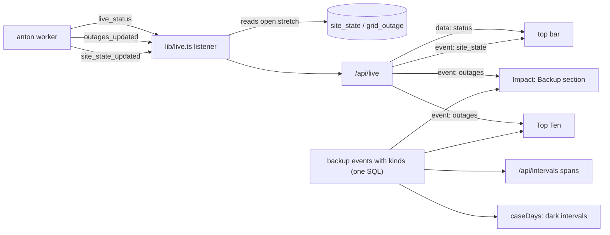

# Design

## Context

anton's grid-outages change (archived there as `2026-11-09-grid-outages`) added two tables and two channels:

- `grid_outage (start_at, end_at)`: every backup event from Tesla, never deleted.
- `site_state (start_at, end_at, island_status, storm_mode_active)`: stretches of what the worker saw, from November 9, 2026, the current one with no end.
- `outages_updated` and `site_state_updated`, each with payload `{}`.
- The live status gains `island_status` and `storm_mode_active`.

anton labels nothing, so tesla-next decides kinds. Measured on November 9, 2026, read-only, from the app's container:

- 94 events: 46 under a minute, 6 in install week, 1 test, and 41 of a minute or more after October 18. With PTO on October 22, a few more of those move to commissioning.
- The house used 85.2 kWh during events in '24 - '25 and 1.8 kWh in '25 - '26.
- `site_state` holds the test and one open `on_grid` stretch; storm watch hasn't been seen yet.

Today `lib/live.ts` listens on `live_status` and `totals_updated` only, and `/api/live` forwards totals as `event: totals`. The top bar formats the live status in `liveStatus` (`lib/live-status.ts`), a pure function. `topTen` returns a fixed three-element tuple. The savings cases come from one SQL query in `caseDays` (`lib/true-up/savings.ts`).

## Goals / Non-Goals

**Goals:**
- One definition of an event's kind, used by every reader: the Backup section, Top Ten, the day view and the savings math.
- Live outage and storm watch states with no polling: the existing notification connection carries them.

**Non-Goals:**
- No dollar value for outage hours (decided in explore).
- The Distribution scene doesn't change; cutting its grid line during an outage would go through `live-flow-scene` in a later change.
- Nothing in anton changes, and nothing here writes.
- No storm watch history before November 9, 2026; there is no source for it.

## Decisions

**One SQL source for kinds.** `lib/backup.ts` exports the events query as a common table expression. It classifies each `grid_outage` row as `commissioning` (start on or before 2021-10-22, PTO day, in site time), `test` (overlaps an `off_grid_intentional` stretch, an open stretch counting as ending now), `blip` (under 60 s) or `outage`. The Backup route, `topTen`, `dayIntervals` and `caseDays` all select from it. The alternative, classifying in TypeScript after the read, would need the rows in memory in `caseDays`, which works per day in SQL.

**The Backup section picks true-up years, not the page's range.** The Impact page's range picker governs its other two sections only. An outage summary for a day or a week is almost always empty, and a year is the unit an outage history reads in. True-up years (October to September) keep each storm season's winter in one year and match the True-Up Tracker. The section reuses the True-Up Tracker's year-picker pattern (three year buttons, Earlier, then All time last, as the owner asked), and it opens on this true-up year. Its choice lives in the address as `backup` (`24-25`, `all`), separate from `start` and `end`, so a link reproduces both. An event belongs to the year its start falls in, in site time. The alternative, a section covering all time only, was the first draft; the owner preferred a year view. With an event spanning September 30, its whole duration counts in the year it began.

**Kinds are computed on read, not stored.** There's no write path, and with about 100 events every read is cheap.

**The server keeps the open stretch on `globalThis` beside the live status.** `lib/live.ts` adds `LISTEN outages_updated; LISTEN site_state_updated`. It reads the open stretch (`WHERE end_at IS NULL`) through the read-only pool once the listener connects, and again on each `site_state_updated`, then forwards the stretch as `event: site_state`. `outages_updated` is forwarded as `event: outages` with `{}`. The layout renders the top bar with both the status and the stretch. Re-reading on every reconnect also covers a notification missed while the connection was down. The alternative was to compute "since" in the browser from the first off-grid status it saw, but that is lost on reload and wrong after a deploy.

**The top bar's added pill comes from `gridPill`, beside `liveStatus`.** It takes the live status and the stretch and returns the pill's kind and text, or none. That keeps the rule pure and unit-tested like the stale rule. "SINCE" shows only while the stretch is itself off grid. anton writes stretches every 5 minutes, so for up to 5 minutes the pill reads OFF GRID with no time.

**Duration formats.** The list and summary show "52 h 16 m" (a blip "18 s"). Top Ten shows hours to one decimal ("52.3 h"), matching its kWh figures, with ties to a tenth of an hour. Each ranking entry carries its unit, so `Ranking` and `Timeline` read it from the entries, and an `outageEntries` mapper sits beside `dayEntries`. `TopTen` becomes a four-element tuple, and the page's reload type follows.

**Day spans ride in `/api/intervals`.** `dayIntervals` returns `off_grid: [{start, end, kind}]` and `storm_watch: [{start, end | null}]` for spans overlapping the day, whole. The day view draws Recharts `ReferenceArea`s, cut to the day's 0 to 1440 minutes, under the flows: the grid's gray for off grid and a light Powerwall green for storm watch. Then it lists the spans in text, which carries the meaning for screen readers. The storm watch line's grid-charge kWh is summed in the browser from the day's intervals (grid to Powerwall) inside the span. A separate `/api/backup?day=` fetch was the alternative, but it would add a second load and a second reload path to the day view.

**Dark intervals in `caseDays`.** The interval query joins the events of kind `outage` or `blip` and computes each interval's dark fraction (its seconds inside an event over 300). The solar-only and no-system figures for the interval scale by `1 - dark`; the actual case and the Powerwall sums are untouched. Peak-only derives from solar-only, so it inherits the change. Tests and commissioning stay lit: without Powerwalls there's no test, and commissioning predates every priced year.

**Storm watch days in `caseDays`.** The day query adds `storm` (any storm-watch `site_state` stretch overlapping the day in site time). `kind()` checks it after `vpp` and before `held`. The split adds one more pricing, `asSolarOnly(["held", "vpp", "storm"])`, and the response adds `powerwalls_storm` and `storm_days`. With no storm days, that pricing equals the held-and-VPP price, so the part is $0.00 and the card leaves its line out.

**Mockups first for the new section.** The Backup section is new UI, so it starts with mockups in the design system's tokens (two or three layouts of summary and list), and the owner picks one before it is built. The top bar pills follow the existing pill's style and get a quick mockup alongside. The Top Ten card reuses `Ranking` and needs none. The mockups (https://claude.ai/artifact/2VixWzn7XsYh1DJFaNeGs8) offered A, four tiles over a table, and B, one sentence over rows with duration bars; the owner picked A with B's bars, each bar the event's length against the year's longest, and the pills as drawn: a red outline and dot for an outage, amber for storm watch, dashed gray for a test.

## Risks / Trade-offs

- [The savings figures shift: about 85 kWh of '24 - '25 house use leaves the what-if cases, so "Solar saved" and "Powerwalls added" move by tens of dollars, and their spec scenarios name the old figures.] → The change recomputes '24 - '25 and '25 - '26 on onyx and updates the affected scenarios in this change's deltas before the archive.
- [`island_status` values other than `on_grid`, `off_grid_intentional` and `off_grid_unintentional` (Tesla also documents a bare `off_grid`).] → Any value starting `off_grid` other than the intentional one reads as an outage; anything else shows no pill.
- [Before November 9, 2026 nothing labels tests.] → Earlier tests read as outages or blips. The owner can add closed `off_grid_intentional` stretches in anton by hand, as anton's rollout did for the first test.
- [A stretch stored late (anton writes every 5 minutes, or later after downtime) labels an event late.] → Kinds are computed on read, so the next read corrects them, and `site_state` changes trigger the reloads.
- [Thin spans: a blip is a fraction of a pixel.] → The text list under the chart always names it.
- [`test/schema.sql`'s `grid_outage` and `site_state` are written by hand from anton's models (`api/models/grid.py`), since a schema dump on onyx was not allowed from this session.] → They follow `init_db`'s definitions; the next documented regeneration replaces them with the dump.
- [`TopTen` changes shape.] → Only the route, the page and its tests consume it; `/api/top-ten` has no outside callers since the compare scripts were removed.

## Migration Plan

1. Deploy as a release (`v*` tag, with the owner's go-ahead). No schema change; it reads tables that already exist.
2. Check on teslasolar.report: the Backup section's figures against a direct read-only query, the outage ranking, a day view of 2024-02-04, and the savings card's new figures against the onyx run. Do a Go Off-Grid test only if the owner wants to see the top bar live.
3. Rollback: redeploy the previous tag. Nothing is stored.

## Results

- **Recomputed on onyx, November 9, 2026, before the pull request** (task 7.4): a build of this branch ran beside the live app in a throwaway container on onyx, with the same read-only login, and was removed afterwards. With outage and blip time dark in the other cases:

  | | '24 - '25 before | '24 - '25 after | '25 - '26 before | '25 - '26 after |
  |---|---|---|---|---|
  | No system | $7,549.41 | $7,508.26 | $6,694.67 | $6,693.86 |
  | Solar only | $814.54 | $799.98 | $967.23 | $966.56 |
  | Actual | $946.82 | $946.82 | $1,118.07 | $1,118.07 |
  | Solar saved | $6,734.87 | $6,708.28 | $5,727.44 | $5,727.30 |
  | Powerwalls added | -$132.28 | -$146.84 | -$150.84 | -$151.51 |
  | Held / VPP / used | -94.45 / 73.28 / -111.11 | -95.34 / 73.28 / -124.78 | -83.08 / 42.50 / -110.26 | -83.40 / 42.50 / -110.61 |
  | Peak-only | $820.23 | $806.09 | $985.39 | $985.01 |

  Day counts and efficiencies are unchanged, and both years have 0 storm watch days. The spec scenarios carry the new figures.
- **Backup history, all time:** 94 events, 35 outages, 44 blips, 14 commissioning (on or before PTO day, October 22, 2021) and 1 test. The outages total 156.9 hours, the longest 52 h 16 m from February 4, 2024, and the house used 206.9 kWh through them, 130.0 from the Powerwalls and 76.3 from solar. The outage ranking leads with February 4, 2024 (52.3 h), December 14, 2024 (35.4 h), August 9, 2022 (11.4 h) and June 3, 2024 (10.5 h). PTO day's 11.3-hour event first counted as an outage; the owner had PTO day count as commissioning, and these figures are recounted that way (read-only, from the live app's container). The savings figures above don't move, since every priced year is after it.

## Rollout

- **Release `v2026.11.09.1`** (merge `999e67e`): its Deploy run passed at 18:46 UTC on November 9, 2026, and onyx runs the merge commit. `/api/backup`, `/api/backup?year=all` and `/api/top-ten` answered 200.
- **Backup figures:** `/api/backup?year=all` gives 94 events (35 outages, 44 blips, 14 commissioning, 1 test), 156.9 hours, the longest 52 h 16 m from February 4, 2024, and 206.9 kWh (Powerwalls 130.0, solar 76.3), the same as the direct read-only recount before the pull request. This year (`/api/backup`) has no outages and lists the morning's test. The Impact page shows the same tiles and all 94 rows.
- **Top Ten:** the outage ranking leads with February 4, 2024 (52.3 h, 16.9 h ahead of December 14, 2024), then August 9, 2022 and June 3, 2024.
- **Day view:** 2024-02-04 shades three spans on its chart and lists them: two one-minute outages at 12:30 and 2:27 PM, then the long one from 2:51 PM to midnight.
- **Savings:** `/api/true-up-savings` answers the recomputed figures of the Results table for both years, with no storm watch days.
- **Live:** a stream opening on `/api/live` sends the latest status, then `event: site_state` with the open stretch (`on_grid` from 17:15:21 UTC, no storm watch). On the grid, the top bar shows no added pill. No Go Off-Grid test was run.
- **Pages:** Impact (All time and this year), Top Ten and the 2024-02-04 day view at 1280 and 375 pixels, in a headless browser: no console errors and no sideways scrolling.
