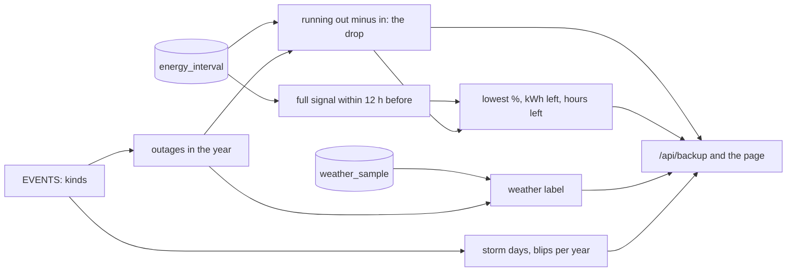

# Design

## Context

The Backup section (archived change `2026-11-09-backup-history`) reads `grid_outage` through `EVENTS` in `lib/backup.ts`, which gives each event its kind. `backupHistory(range)` answers the summary and the events in two queries, and `BackupSection` draws the tiles and a row for each event.

Facts this design rests on, from read-only checks on November 9, 2026:

- **No charge history from Tesla.** `calendar_history?kind=soe` answers 400; Teslemetry allows only `backup` and `energy` there. `battery_sample` starts on 2026-10-17 and covers only the morning's test.
- **The 5-minute flows cover every outage.** `energy_interval` starts on 2021-10-10, and so does `weather_sample` (wind in km/h, WMO weather codes).
- **The calibration.** Comparing the 6,607 battery samples with the flows over the same intervals: 1% is about 0.36 kWh out of the batteries and 0.41 kWh into them, so about 36 kWh from full to empty, less than the 40.5 kWh nameplate.
- **The full signal.** An interval of solar exported while the batteries took none read 100% in 479 of 501 sampled cases, and 99% in 10 more.
- **How outages start.** 9 of the 11 long outages since 2022 began within minutes or hours of that signal, with almost no net change in between; 2022-08-09 and 2025-08-23 began 10 to 12 kWh down.
- **Some deepest drops:** February 4, 2024: 20.6 kWh; December 14, 2024: 23.1 kWh; June 3, 2024: 10.8 kWh. Over the February outage the batteries gave out 42.4 kWh in all.
- **Blips by calendar year:** 3, 10, 27, 0, 3 and 1 from 2021 to 2026.

## Goals / Non-Goals

**Goals:**
- Every rebuilt figure comes from one place, `lib/backup.ts`, and is tested on the throwaway database.
- No new tables, jobs or anton changes. All of it is read when the page and the route are.

**Non-Goals:**
- Car charging during outages: `vehicle_interval` starts on 2026-10-17, so no outage has it yet.
- A capacity that changes with the batteries' age. One measured constant serves every outage (see Decisions).
- Storm watch hit rates: there is no storm watch history yet.
- Saying why blips fell after 2023.

## Decisions

**The arithmetic runs in TypeScript over each outage's intervals, read in one query.** The query returns, for the year's outages, their intervals from 12 hours before the start to the end, ordered by time: battery out and in, solar exported, house use. A pure function `outageBattery(intervals, outage)` then finds the full signal, the running total, the drop and its time, and the draw before it. A query of about 35 outages of up to 52 hours each, plus 12 hours before each, is a few thousand rows a year and about 15,000 for All time. Doing it in TypeScript keeps the rules in one tested function, where the window logic in SQL (a running sum, a "last full interval before" and a draw over a moving hour) would be three nested queries. The cost is reading those rows on each load, which is small next to the savings query.

**Constants.** `KWH_PER_PERCENT_OUT = 0.36`, `CHARGE_EFFICIENCY = 0.36 / 0.41`, `CAPACITY_KWH = 36`, `FULL_LOOKBACK = 12 h`, `FULL_TOLERANCE = 1 kWh`, each with a comment saying where it came from. One capacity for every year was chosen over a capacity that grows toward 40.5 kWh for older outages: it reads early outages as slightly closer calls than they were, which errs toward caution, and it needs no wear model nobody can check.

**Energy in counts at 0.36/0.41.** Stored energy goes down by 0.36 kWh a percent and up by 0.41 kWh a percent, so a kWh going in raises the charge by 0.88 of what a kWh going out lowers it. Counting both at face value would make solar refills look 14% bigger than they are.

**The full signal must come before the start.** While the grid is down the batteries can't export, so the signal can only be seen before the outage. Started-full needs that interval within 12 hours and the batteries' net change between it and the start under 1 kWh. Otherwise the outage gives only its drop, which needs no anchor. That rule matches the 9-of-11 finding, and puts 2022-08-09 and 2025-08-23 among the drop-only outages.

**Hours left use the hour before the low point.** The lowest point is usually just before dawn, when the house draws its overnight load. That hour's average is a better guide to how long the rest would have lasted than the outage's average, which mixes in daytime solar. An hour with no draw gives no hours left.

**Solar refilled when the batteries gave out more than 36 kWh.** That is a plain fact, since they can't give out more than they hold without being refilled, and it needs no anchor. Smaller refills aren't labeled: they would need the start charge to prove.

**Weather.** For each outage, the strongest wind and the highest-coded weather between 3 hours before and 1 hour after its start (outages often begin before the storm's peak sample). Rain comes from `rainFrom` in `lib/intervals/weather.ts`, which already ranks the WMO codes: 0.7 and up is heavy rain, anything above 0 is rain, codes 95 to 99 are a thunderstorm. Wind of 40 km/h or more is high wind, 25 km/h or more is windy. With neither, it reads Calm. These cutoffs are a first guess, tuned against the outages above: the February 2024 and February 2025 storms read high wind and the summer outages read calm.

**Storm days are grouped in the list from the events it already has.** Grouping is by gap: an event starting less than 6 hours after the previous one ended joins its group. It covers outages and blips only; tests and commissioning stay alone. It is done in TypeScript over the year's events. A group's line gives its first day, its count and its summed time off the grid, and its rows follow it, indented. The tiles still count outages, not groups.

**Blips per year** come from the same events, counted by true-up year in TypeScript. That is one line, with no chart.

**Mockups first.** The fifth tile, the blips line, the storm-day heading and the denser rows change the layout picked in backup-history (tiles over a table with duration bars), so the section gets new mockups at 1280 and 375 pixels before it is built, and the owner picks one. The owner picked D (https://claude.ai/artifact/2VixWzn7XsYh1DJFaNeGs8, second row): each outage keeps its row and gains a muted detail line (weather, lowest charge or drop, solar refill), storm days get a heading line, and the five tiles sit over a blips line.

## Risks / Trade-offs

- [The calibration was measured on today's batteries above the 20% reserve.] → The section says the figures are estimates. Early outages read slightly low. No sample falls below the reserve, so a drop deep enough to go below 20% is the least certain figure. The first real outage logged by `battery_sample` checks the method (tasks).
- [The full signal misses a full battery that wasn't exporting, such as at night.] → An outage after a full evening still finds the afternoon's signal within 12 hours, with its net change since then, mostly overnight draw, counted. If that change is 1 kWh or more, the outage gives its drop only. Showing less is better than showing a wrong percentage.
- [Missing intervals inside an outage.] → The running total skips them, which can understate a drop. An outage with fewer than 80% of its intervals present gives its drop marked as incomplete, with no charge.
- [Weather samples are hourly and come from a service, not the house.] → The label describes the area's weather, and the section says so.
- [The page reads more rows on each load.] → About 15,000 rows for All time, by the `energy_interval` primary key in time ranges, once per load and per reload event.

## Migration Plan

1. Release as usual, with the owner's go-ahead. Nothing in the database changes.
2. Check on teslasolar.report that February 4, 2024 shows about 39% and solar refilled, that December 14, 2024 and August 9, 2022 show their drop only, and that Closest call reads ~39% on Feb 6, 2024 for All time.
3. Rollback: redeploy the previous tag.

## Open Questions

- The weather cutoffs and labels may be retuned after the mockups, without changing the approach.

## Results

- **Run on onyx, November 9, 2026, before the pull request** (task 4.3): a build of this branch ran beside the live app in a throwaway container with the same read-only login, and was removed afterwards. `/api/backup?year=all` answered in 200 ms.

  | Outage (site time) | Hours | Weather | Drop | Started full | Lowest | Left | Hours left | Refilled |
  |---|---|---|---|---|---|---|---|---|
  | Feb 4, 2024, 2:51 PM | 52.3 | Heavy rain, high wind | 22.0 kWh | yes | ~39% (Feb 6, 8:05 AM) | 14.0 kWh | 11 | yes |
  | Dec 14, 2024, 5:55 AM | 35.4 | Heavy rain, windy | 23.6 kWh | no | | | | no |
  | Jun 3, 2024, 4:35 PM | 10.5 | Calm | 10.7 kWh | yes | ~70% | 25.3 kWh | 28 | no |
  | Jan 20, 2024, 6:23 PM | 7.5 | Heavy rain, windy | 9.4 kWh | yes | ~74% | 26.6 kWh | 28 | no |
  | Feb 4, 2025, 3:09 PM | 5.5 | Heavy rain, high wind | 7.7 kWh | yes | ~79% | 28.3 kWh | 21 | no |
  | Aug 23, 2025, 1:14 AM | 7.2 | Calm | 5.8 kWh | no | | | | no |
  | Aug 9, 2022, 9:21 AM | 11.4 | Calm | 0.0 kWh | no | | | | no |

  Closest call for All time is ~39% on February 6, 2024. Blips per true-up year: '21 - '22 8, '22 - '23 32, '23 - '24 0, '24 - '25 2, '25 - '26 2, '26 - '27 0.
- **Against the explore-mode figures:** the February 2024 drop reads 22.0 kWh where the check from anton's container read 20.6, because energy into the batteries counts here at 0.36/0.41 of itself, as decided above, not at face value. December 14, 2024 began before dawn, more than 12 hours after the last full signal and after a night's draw, so it gives its drop only; the earlier ~36% assumed a full start. The spec's scenarios carry the run's figures.
- **Short outages that started full** read "lowest ~100%" with a long "hours left" (the hour before the start's draw), such as 2023-01-17's "~100%, ~36.0 kWh and ~66 h left". True, but noise, so after the run the owner had the line leave out both the drop and the charge when the drop is under 0.05 kWh (spec: A drop too small to show). Closest call still counts such an outage, so a year whose only full starts are blips of that size reads about 100%.

## Rollout

- **Release `v2026.11.09.2`** (merge `c575e9e`): its Deploy run passed at 20:06 UTC on November 9, 2026, and onyx runs the merge commit. `/api/backup?year=all` answered in 376 ms from outside, through Cloudflare.
- **Figures:** the live answer matches the onyx run of the Results above outage for outage: February 4, 2024 lowest ~39% with 14.0 kWh and about 11 h left, solar refilled; February 4, 2025 ~79%; June 3, 2024 ~70%; January 20, 2024 ~74%; December 14, 2024 and August 9, 2022 drop only. Closest call ~39% on February 6, 2024, and blips per true-up year 8, 32, 0, 2, 2, 0.
- **Page:** `/impact?backup=all` at 1280 and 375 pixels in a headless browser shows the five tiles, the blips line, 13 storm days (February 4, 2024 as 3 outages, 52 h 18 m off the grid, its long outage's line reading "Heavy rain, high wind · lowest ~39%, ~14.0 kWh and ~11 h left · solar refilled the Powerwalls" and its one-minute outages their weather only) and all 94 events, with no console errors and no sideways scrolling.
- **Still open:** task 5.3, comparing the rebuilt lowest charge with `battery_sample` at the first real outage it logs.
