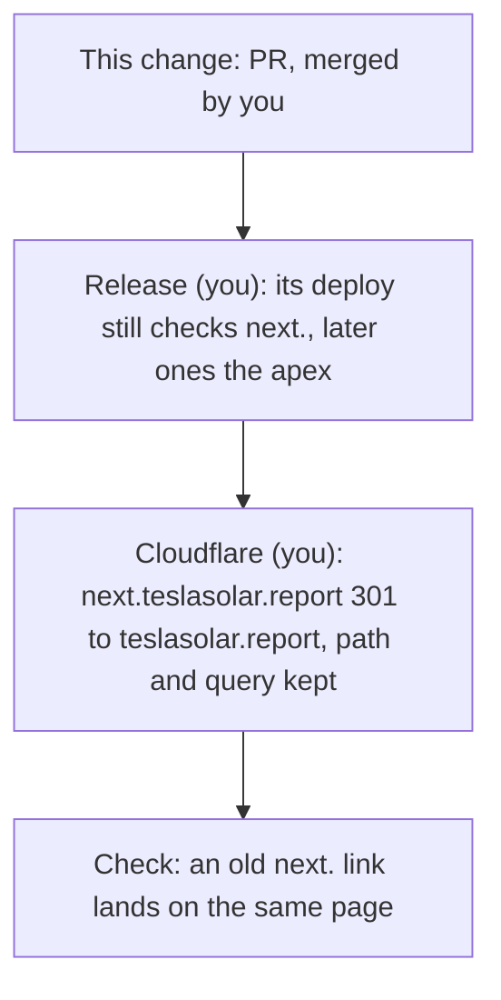

# Design

## Context

anton-tesla-api-ws's `retire-flask-web` deployed on November 9, 2026: its `flask` container runs `python worker.py`, nginx is gone, and only the `live_status` and `totals_updated` notifications and the database come out of it. teslasolar.report has been this app since November 8 (the cutover change, 7a). What 7a left for now is in its design: the compare scripts and their README section, the parity traps in CLAUDE.md, the deploy's health check on next.teslasolar.report, and next.teslasolar.report itself. top-ten-without-vpp left one more: `/api/top-ten`'s default stayed Flask's (VPP days included) while the page's default left them out.

## Goals / Non-Goals

**Goals:**

- No code, test, script, spec or doc in this repo compares with or defers to Flask's HTTP side.
- `/api/top-ten` and the Top Ten page agree on the default.
- The deploy checks the address visitors use, and the preview address keeps old links working.

**Non-Goals:**

- Changing any number a visitor sees. The range sums, their float order and rounding, the periods, Python's `round`: they stay, and their comments say what they do rather than whom they match.
- Making Top Ten's With VPP view consistent across the April 27, 2026 meter fix; a change of its own.
- Deleting `tsr-tunnel` in anton-tesla-api-ws; you do that there.

## Decisions

**Delete the compare scripts outright.** They can't run without Flask, and git history keeps them. Their `.test.mjs` files go with them; `scripts/audit.mjs` stays.

**`/api/top-ten`: `vpp=with` includes VPP days, anything else leaves them out.** This is the page's own reading of `?vpp`, so the route and `/top` share one rule. `?vpp=without`, which the page sends today, keeps answering the same, so a page open during the deploy keeps working; the page then asks for `/api/top-ten` and `/api/top-ten?vpp=with`.

**Comments: drop the parity reason, keep the provenance.** "Answers as Flask's ... until cutover" goes from the six routes. "Ported from anton-tesla-api-ws ..." stays, since it says why the code looks as it does and where the original reasoning lives. Comments that name Flask's still-running parts as "Flask" (the notifications in `lib/live.ts`, the live sunshine and weather in `lib/intervals/`) say "anton's scheduler", since that is what sends them now. Code that reproduces Python (`lib/intervals/python.ts`, the range sums) keeps doing so; its comments say the numbers stay as they have always been shown.

**Specs: replace each "matches Flask's" requirement rather than edit it.** OpenSpec won't let a modified requirement drop a scenario, and each of these has a "compared with Flask" scenario, so each is removed and its non-parity content (the route, its shape, its 400s) is added back under a plain name. The two rules that were defined only by Flask (the range periods, the meter correction) are written out from `lib/solar/ranges.ts` and `lib/range.ts`. `live-status-stream` drops the two requirements on what anton sends, which anton's own specs now hold. Purposes that mention Flask (`live-status-stream`, `database-access`) are edited in the main specs at archive.

**The health check moves to the apex from the next release on.** A deploy runs the `bin/deploy` the server had before it (README, Releasing), so this release's own deploy still checks https://next.teslasolar.report/, which answers 200 until the redirect, and every later release checks https://teslasolar.report/. That is why the redirect comes after this release's deploy. `DEPLOY_HEALTH_URL` still overrides it.

**The redirect is a Cloudflare Redirect Rule, after the release.** It needs next.teslasolar.report's DNS record to stay proxied, so the record stays and only its tunnel route goes; the rule sends 301 to `https://teslasolar.report` with the path and query. It comes after the release so no deploy checks a redirect.

## Risks / Trade-offs

- [A client calls `/api/top-ten` expecting VPP days] → only this app's page calls it, and it moves to `?vpp=with` in the same release; the README says the default.
- [Deleting the redirect's tunnel route also deletes its DNS record] → Cloudflare removes a tunnel's CNAME with its route; the record is re-added as proxied before the rule (or the route kept until the rule works), and the check opens an old link.
- [A comment sweep changes code by accident] → the suite and `yarn build` run after it, and the diff of the sweep holds only comment lines.

## Migration Plan

1. PR with this change and the two rollout commits; you merge.
2. You publish the release; its deploy still checks next.teslasolar.report, and later releases check https://teslasolar.report/
3. You add the redirect in Cloudflare; I check that https://next.teslasolar.report/distribution?at=2026-11-07T12:30 lands on the same address at teslasolar.report, and that `/top` and `/api/top-ten` agree.

Rollback: the release's own rollback (`tesla-next-next:previous`) brings back the old route default and health check; the redirect is undone in Cloudflare.

## Rollout

Recorded as tasks 5.1 to 5.3 run.
