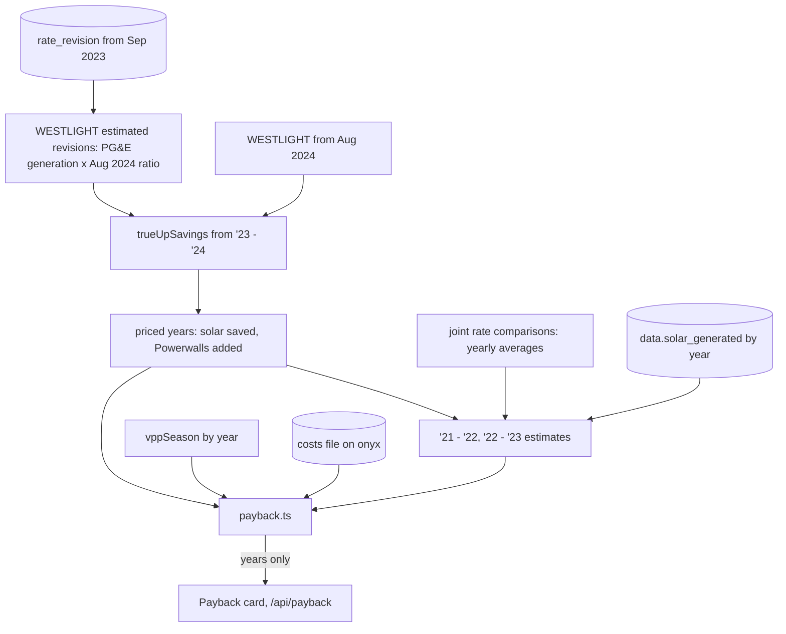

# Design

## Context

`trueUpSavings(start, end)` in `lib/true-up/savings.ts` prices a true-up year in three cases from PG&E's rates (`rate_revision`, from anton's `seed_rates.py`) and WestLight's (`WESTLIGHT` in `lib/true-up/westlight.ts`), and answers null before `FIRST_YEAR = "2024-10-01"`. What is stored, checked read-only on November 9, 2026:

| | '21 - '22 | '22 - '23 | '23 - '24 | '24 - '25 on |
|---|---|---|---|---|
| Tesla's 5-minute data | 356 days | 365 days | 366 days | all |
| PG&E's daily readings (`meter_day`) | none | none | 361 days, from Oct 6 | all |
| PG&E rates (`rate_revision`) | none | none | from Sep 1, 2023 | all |
| WestLight rates | none | none | none | from Aug 1, 2024 |
| Meter reads (`meter_read`) | estimated | estimated | 2024's stored, 2023's estimated | stored |

PG&E's Green Button download doesn't reach before October 2023, which is why the readings stop there. Before the April 2026 meter fix, Tesla's grid readings were about half of PG&E's, and the savings rebuild them from PG&E's readings, so '21 - '22 and '22 - '23 can't be priced day by day however their rates are found.

PCE and PG&E's joint rate comparisons (E-TOU-C, average residential customer) give one yearly average per provider:

| Rates as of | PG&E generation | PCE ECOplus generation | PCE ECO100 total | Source |
|---|---|---|---|---|
| March 2021 | $0.10979 | $0.05625 | $0.30334 | 2021 mailer (CPUC customer notices) |
| January 2023 | $0.13657 | $0.13870 | $0.35142 | PCE San Mateo comparison, January 2023 |
| July 2023 | $0.13578 | $0.13795 | $0.35931 | PCE San Mateo comparison, July 2023 |

No 2022 mailer was found (the CPUC lists an unlabeled "JointRateMailer_2022_ETOUC"), but the January 2023 comparison, in the middle of '22 - '23, serves that year.

## Goals / Non-Goals

**Goals:**
- One more priced year, '23 - '24, with its single estimate named on the card.
- A payback answer for each part that says plainly what is priced, what is estimated and what is left out.
- The owner's costs never leave onyx: not in the repository (public), the specs, the tests, the route's answers or the page (public).

**Non-Goals:**
- A PG&E rate history before September 2023, or day-by-day pricing of '21 - '22 and '22 - '23: without PG&E's readings their energy is unreliable.
- Valuing backup in dollars (decided in backup-history).
- Financing, maintenance or battery replacement costs: there are none to count.
- Powerwall savings before '23 - '24: they can't be priced, and an estimate would invent money in one direction or the other.

## Decisions

**WestLight's estimated revisions are fixed numbers in `WESTLIGHT`, not computed when read.** PG&E's generation rate for each period of each revision from September 2023 to July 2024, read read-only on onyx (2.1), times that period's ratio of WestLight's first known sheet (2024-08-01) to PG&E's generation rate in effect that day (the 2024-07-01 revision): summer peak 0.20001 / 0.21555 = 0.92791, summer off-peak 0.12116 / 0.13255 = 0.91407, winter peak 0.14296 / 0.15549 = 0.91942, winter off-peak 0.11761 / 0.12881 = 0.91305. Rounded to 5 places, with ECO100 and the bonus at 1 cent and `estimated: true`, written into the file with a comment on how they were made. 2024-04-01 repeats 2024-03-01's rates, so it isn't listed; 2024-07-01's estimate equals the August sheet, as it should. Computing them from `rate_revision` on each read would tie WestLight's code to PG&E's table for 11 months that never change again.

The joint rate comparisons were the first source considered (July 2023: PCE's average 1.6% above PG&E's), but the comparisons average a typical customer's bill and mix PCIA vintages, while the August 2024 ratios are on exactly the basis the savings price (PCE's sheet against `rate_revision`'s generation columns). They put PCE about 8% below PG&E in every period. The owner chose the August 2024 ratios. The assumption is that PCE's discount held from September 2023.

**`FIRST_YEAR` moves to `"2023-10-01"`, and the savings carry `estimated_rates`**, true when any day was priced at an estimated revision. The card's estimates note (true-up-tracker) names it. The days before October 6, 2023 with no PG&E reading count as Tesla's, as days without a reading do now.

**'21 - '22 and '22 - '23 are estimated as whole years in `payback.ts`, for solar only.** Their estimate is the '23 - '24 saving × (that year's solar kWh / '23 - '24's) × (that year's average cost / '23 - '24's). Solar kWh comes from `data.solar_generated`; the meter fault was in the grid readings, not solar's. The average cost index is the ECO100 total from the comparisons: $0.30334 for '21 - '22 (March 2021 rates), $0.35931 for '23 - '24 (July 2023). For '22 - '23 it is January 2023's, $0.35142. Each is the comparison nearest its year; '21 - '22's and '23 - '24's both come from just before their years, so they lean the same way. The second step uses solar's own kWh, not the house's, because what solar saved scales with what it made, at the price each kWh displaced.

**Payback counts from PTO, October 22, 2021.** '21 - '22 starts October 1; its estimate is scaled to the 344 days from PTO. The payback date is found by walking the years in order, adding each year's saving until the sum passes the net cost, then placing the crossing at an even rate through that year's days (the current year through its last counted day). Before then, the rest is projected at the priced years' average. Only the date's year is shown.

**Solar for the whole system** walks the same years against the two net costs added, solar's savings only: the Powerwalls' small VPP net isn't counted toward it, so the question stays "when has solar alone paid for everything". It is another year, and the two years together still bound the cost only to within a year's savings.

**The Powerwalls count only priced years.** Their net is the sum over priced years of `powerwalls_added` and `vppSeason(end year)` (payout, or estimate). The rest of their net cost over the average net per priced year gives the years still needed. Over 10 years (their warranty), or a net of zero or less, the card says they won't pay for themselves in dollars and gives the outage record from `backupHistory(all time)`: count, hours, longest, linking to `/impact?backup=all`. Otherwise it gives the projected year.

**The costs live in a JSON file on onyx, read like the database password.** `SYSTEM_COSTS_FILE` in `.env` names the host path; `docker-compose.yml` mounts it read-only into the container at a fixed path, as `PGPASS_FILE` is. The file holds `{"solar": ..., "powerwalls": ..., "sales_tax": ..., "credit_rate": ...}`, with the owner's figures, and is created on onyx by hand, never committed. `payback.ts` reads it once per request (it is tiny) and answers null when it is missing or malformed, so a deploy without it shows no card rather than failing. Tests use placeholder figures and a temporary file. Constants in code were the first plan, and were dropped because the repository and the site are public.

**Only years leave the server.** The route and the card give solar's payback year (marked projected, or resting on estimated years) and the Powerwalls' year or "won't pay for themselves in dollars". No cost, net cost, amount left or percentage is sent. The public savings card already gives each year's savings, so a payback year bounds the cost to within a year's savings: that is the precision the owner accepted. A month would narrow it to about $500, so the card gives the year.

**The card sits below the cycle list for every range**, since payback is the system's whole life. It is rendered with the page from `payback()` and reloaded through `/api/payback` with the savings on `totals` events and a reopened stream. Mockups first: it is new UI. The owner picked B (https://claude.ai/artifact/5QfVBJ8XiYLyYba6jBr4iA): a heading sentence with the two solar years, a timeline from PTO to the end of the Powerwall warranty (2031) marking solar's payback, today and the whole-system year, solid up to today and dashed after, then the Powerwalls' line with their outage record. On a phone the timeline runs down the card.

**Finished years are priced once per server process** (review fix). `payback()` needs every priced year's savings, which took 2.2 s on onyx, and runs on each True-Up page render and each totals event for today. A finished year's savings don't change, so they're kept in a map on `globalThis`, as `lib/live.ts` keeps its state, and only the current year is priced again. A deploy restarts the process, which also takes in any correction anton makes to past days.

**Solar output counts from PTO** (review fix). '21 - '22's estimate is scaled by its solar output from PTO, and the year starts at PTO in the payback walk, so it isn't cut to PTO a second time.

## Risks / Trade-offs

- [The August 2024 ratios are one point applied to the 11 months before it.] → The card names the estimate. '23 - '24 moves by a few dollars per cent of ratio, and the rest of the year's figures are priced.
- [The early estimates assume '23 - '24's mix of when solar was used and exported.] → They are marked estimates, and they only move solar's payback month; the card shows the month, not a day.
- [The credit is taken as a rate on the total, not the owner's actual Form 5695 figure.] → The rate is one field in the costs file, which the owner can correct on onyx with no deploy.
- [A costs figure leaking through a log or an error.] → `payback.ts` logs only that the file is missing or malformed, never its contents, and CLAUDE.md gains the rule never to commit or print the costs.
- [VPP estimates for unpaid seasons.] → Marked as estimates, as the VPP credit tile marks them.

## Migration Plan

1. With the owner's go-ahead, create the costs file on onyx (outside the repository, readable only by the owner's account) and add `SYSTEM_COSTS_FILE` to onyx's `.env`. Then release as usual. Nothing in the database changes.
2. Check on teslasolar.report: '23 - '24's savings card with its estimate note, the Payback card's years against an onyx run of the branch before the pull request, and that `/api/payback` holds no dollar amount.
3. Rollback: redeploy the previous tag.

## Results

- **Costs file on onyx, November 9, 2026** (task 5.3, with the owner's go-ahead): `~/tesla-next-costs/system-costs.json`, mode 600 in a mode 700 directory owned by the owner's account, holding the owner's figures; `SYSTEM_COSTS_FILE` added to onyx's `.env`. Its contents appear nowhere else.
- **Run on onyx before the pull request:** a build of the branch in a throwaway container beside the live app (same read-only login, the costs file mounted read-only), removed afterwards.
  - `/api/payback` (2.2 s): solar paid for itself in **2025** (estimated years counted), solar is projected to pay for the whole system in **2028**, and the Powerwalls won't pay for themselves in dollars; outage record 35 outages, 156.9 h, the longest 52.3 h. The answer held no dollar amount.
  - Savings by true-up year (all public on the savings card already):

    | Year | No system | Solar only | Actual | Solar saved | Powerwalls added | WestLight rates |
    |---|---|---|---|---|---|---|
    | '23 - '24 | $6,507.85 | -$2.80 | $39.90 | $6,510.65 | -$42.70 | estimated |
    | '24 - '25 | $7,508.26 | $799.98 | $946.82 | $6,708.28 | -$146.84 | known |
    | '25 - '26 | $6,693.86 | $966.56 | $1,118.07 | $5,727.30 | -$151.51 | known |
    | '26 - '27 so far | $557.25 | $113.89 | $138.07 | $443.36 | -$24.18 | known |

  - '23 - '24's actual cost of $39.90 is far below the later years'. That fits the year before the household's second EV (`cost.ts` counts years as comparable only from '24 - '25 for that reason): less use, so solar's credits nearly covered it. Its 364 days rebuilt from PG&E's meter means its energy is as good as the later years'; only WestLight's generation rate is estimated.
- The onyx run's years predate the two review fixes; counting '21 - '22 from PTO only once adds about 2.5% to that year's estimate, which leaves solar's 2025 and the whole system's 2028 as they were or earlier. The rollout check confirms the live years.
