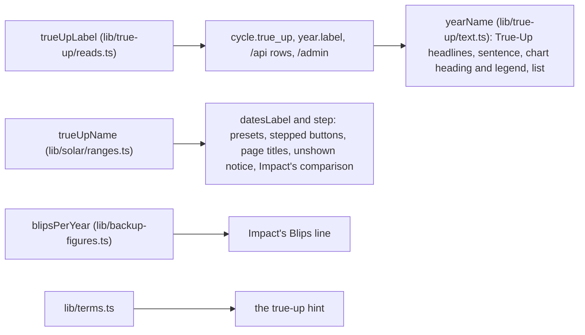

# Design

## Context

Four places build a true-up year's display name today, all as "'25 - '26":

`trueUpLabel` is also a data key: cycle rows carry it as `true_up`, `runningNet` and the list group by it, and `/admin` names statements by it. The cycle list groups years under an `h3` and lays every cycle row out on one grid (`grid-cols-[minmax(0,1.3fr)_repeat(4,minmax(0,1fr))]` from 640 up).

## Goals / Non-Goals

**Goals:**

- One function builds a year's display name, "2025‑26", and every display path uses it.
- The Billed against estimate tile names PG&E's side of the gap.
- At All time the list is one row per year, with only the last year's cycles shown.

**Non-Goals:**

- Changing `trueUpLabel`, the `true_up` field, API data, or `/admin`'s wording (owner-only, and keyed by the label).
- A summary row when one true-up year is shown; the tiles already sum it.
- Remembering which years a viewer opened.

## Decisions

**One name builder in `lib/solar/ranges.ts`.** `trueUpName` there already names a true-up range for `datesLabel`; it becomes exported and takes the start year, giving `${year}‑${next two digits}` with a non-breaking hyphen (U+2011), as the headlines already spell "true‑up". `text.ts`'s `yearName(label)` maps the label to its start year (`20` + its first two digits) and calls it; `blipsPerYear` calls it with its year. The non-breaking hyphen keeps "Year names stay on one line" without the non-breaking spaces `yearName` adds today. Alternative: change `trueUpLabel` itself to "2025-26". Rejected: it would rewrite API data and every DB test fixture for a display change.

**The billed tile's gap from PG&E's side.** `billedText` keeps `gap = estimate - actual`; the unit becomes "more than the estimate" when PG&E billed more (gap < 0) and "less than the estimate" when it billed less. "Exact" and the line under it are unchanged.

**Summary rows as `
`.** Each year is a `
` whose `
` uses the cycle rows' own grid classes (one shared constant), so the year's figures line up with its cycles' at every width. The figures come from `totals()`; the charges reuse `chargesText` with the summed charges and `nem_source` set to "calculated" when any cycle's is, so the "est." and "credit" rules stay in one place. A year where any started cycle has null charges gives none. The browser's marker is hidden and a lucide `ChevronRight` before the year name turns 90° on open (`group-open:rotate-90`), matching the chevrons the range controls use. At All time only the last year listed, the current year, gets `open`; for any other range every year does, since a custom range can cut its first or last year short and a closed row would read as the whole year (found in review). The page passes `allTime` from `isTrueUpAllTime`. `
` gives keyboard and screen reader disclosure without state. Alternatives: a button with `aria-expanded` and state (more code for the same behavior), or rows always shown with only summary figures added (keeps the length the critique flagged).

**No "(so far)" on the open year's row.** Its open cycle's row already says so, just under it.

## Risks / Trade-offs

- Fonts without U+2011 fall back for that glyph → already the case for "true‑up" in the headlines, which ship this way.
- `yearName` assumes years 2000 to 2099 when it rebuilds the start year from a two-digit label → the data starts in 2021.
- Closed years hide their cycles from find-in-page in browsers that don't search `
` → Chrome and Safari open matching `
` on find; the figures a visitor looks for at All time are now the year rows.
- `lib/backup-figures.ts` importing `lib/solar/ranges.ts` adds a dependency → check it creates no import cycle when wiring it.
